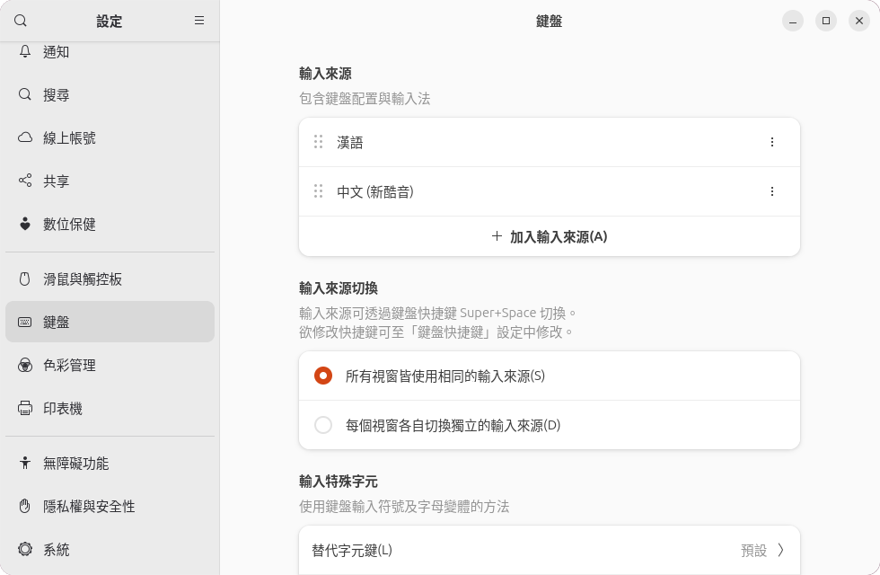
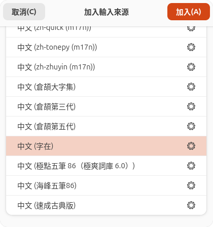
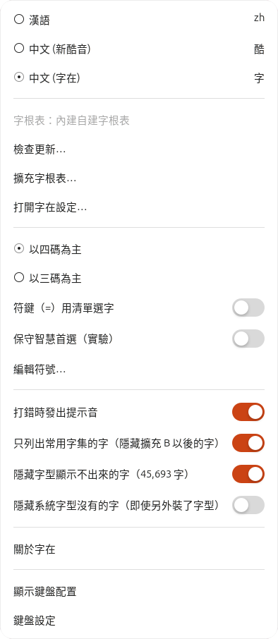
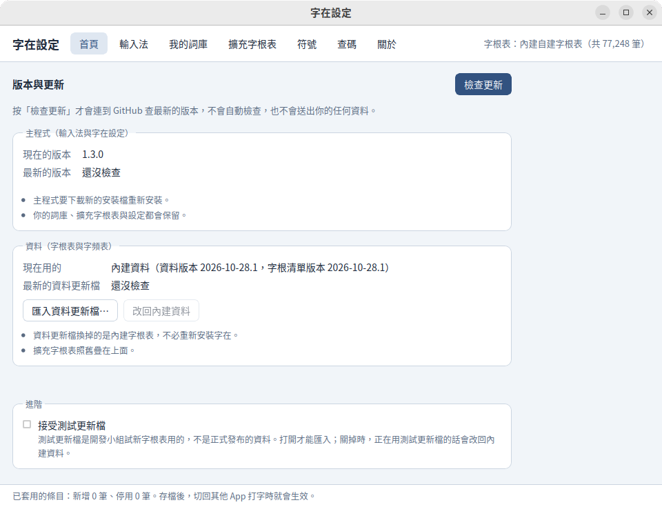
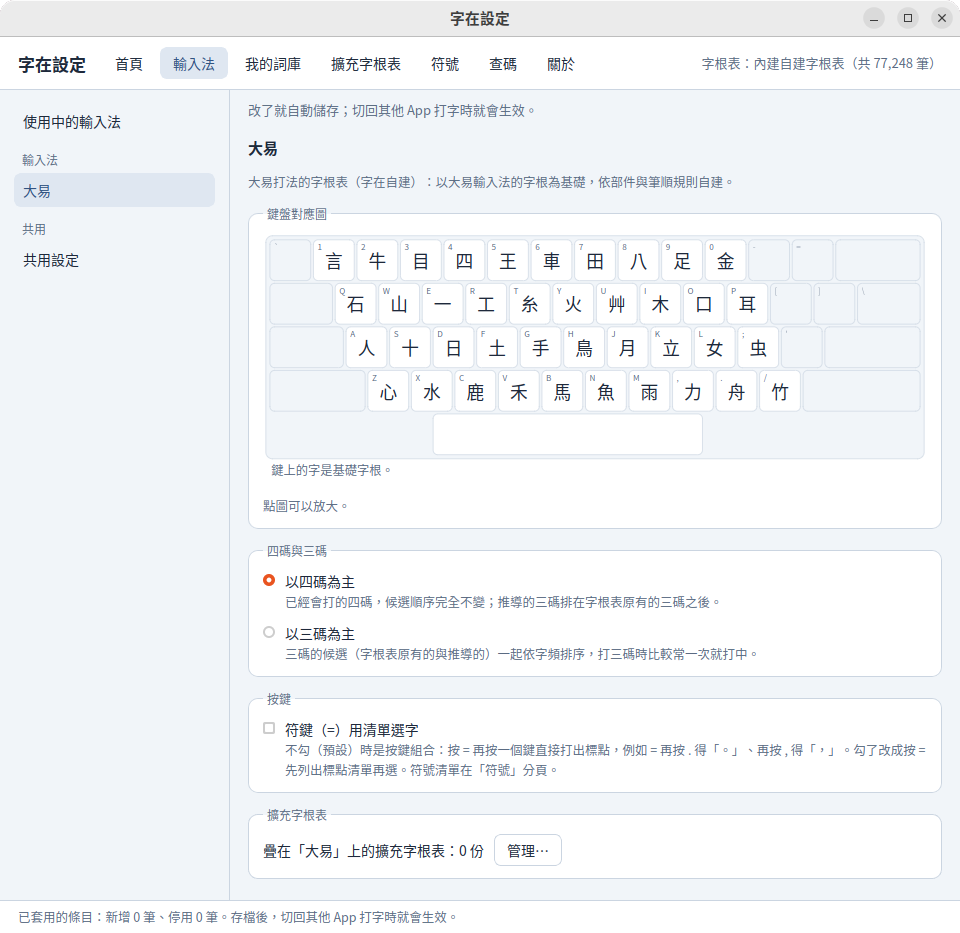
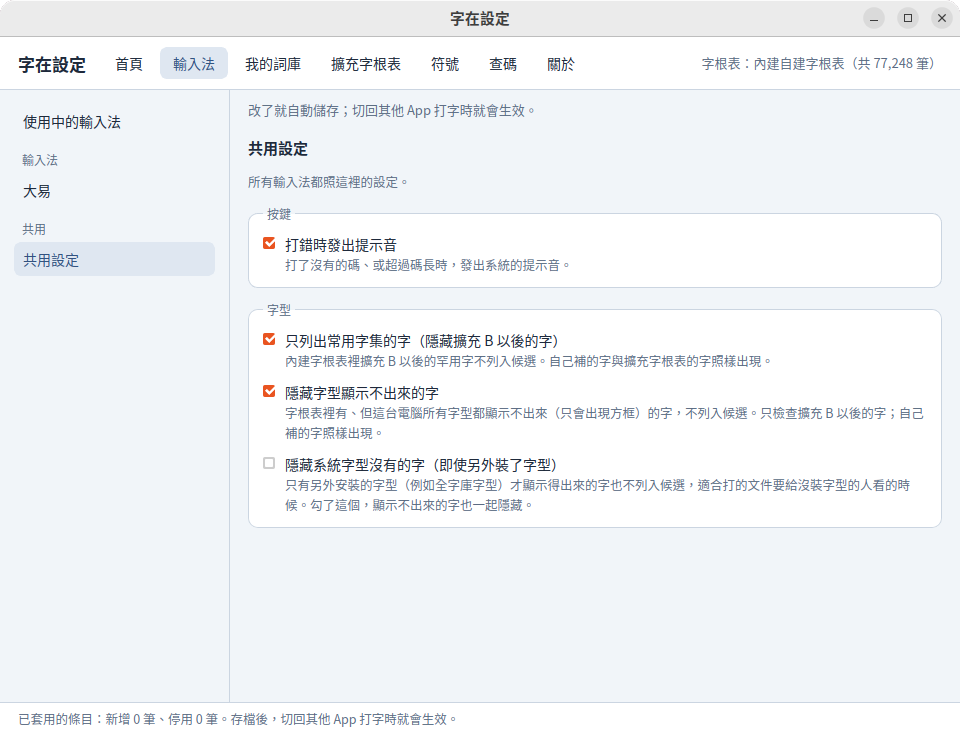
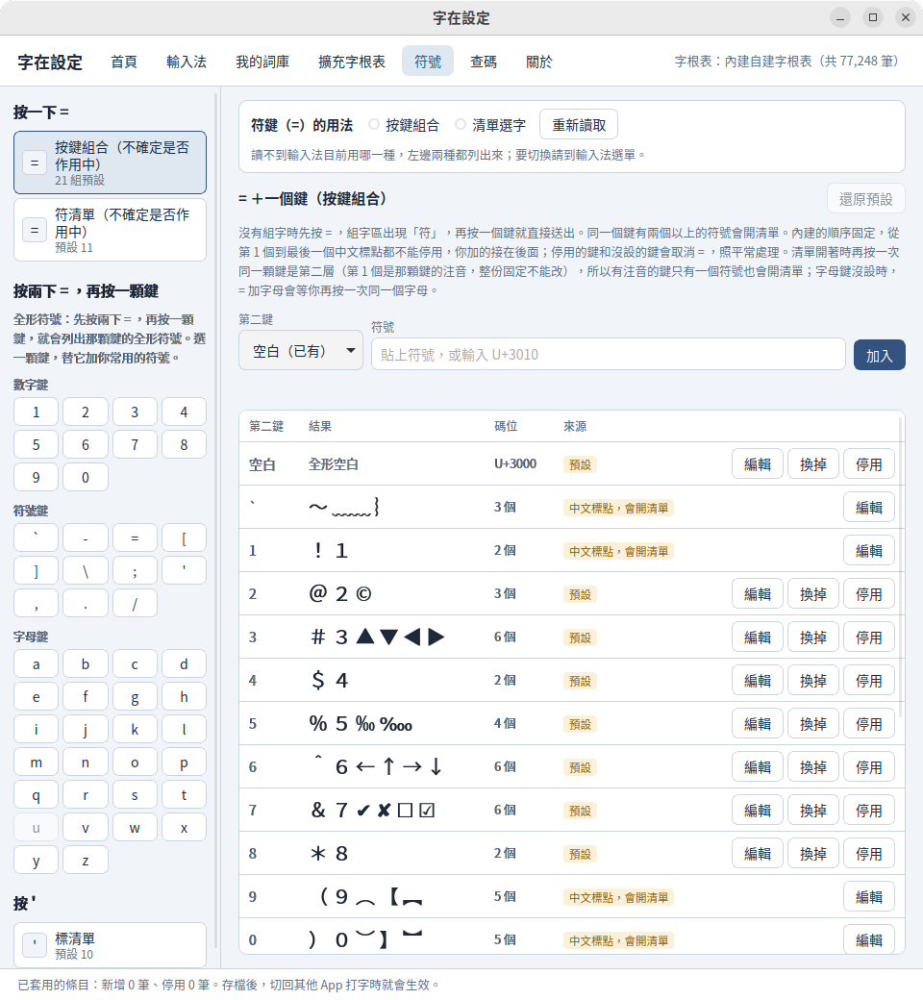
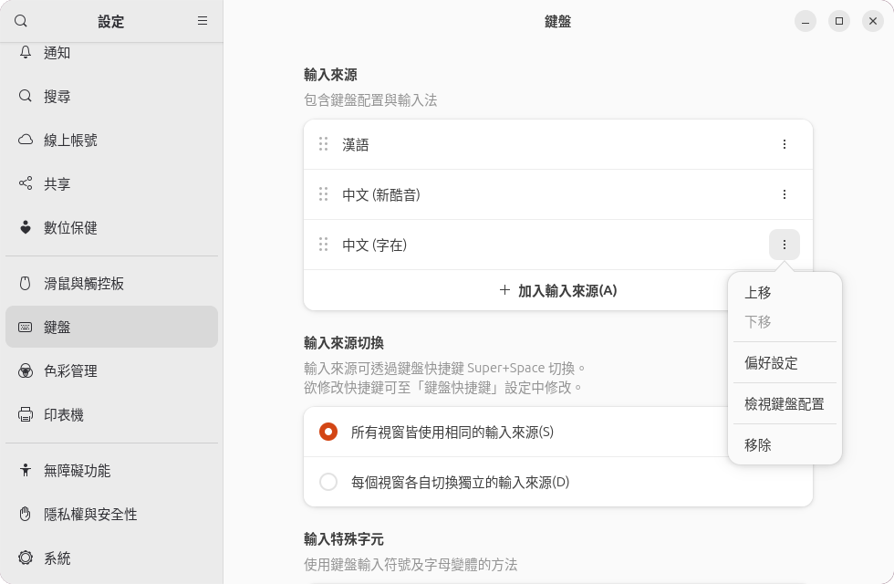

# 安裝與使用（Linux）

這一頁是 Linux 版的安裝、加入輸入來源與移除。打字、字根表、補字與更新和 macOS 版相同，見 [安裝與使用](guide-macos.md)。

**請先看這段**：Linux 版的套件沒有 GPG 簽章，也不在各發行版的官方套件庫裡。請只從 GitHub 上 `zizai-ime/zizai-ime` 的 [Releases](https://github.com/zizai-ime/zizai-ime/releases) 下載，安裝前先核對 SHA-256（「下載與核對」的第 2 步）。

## 系統需求

- x86_64（64 位元的 Intel、AMD）電腦。還沒有 ARM64 版。
- 輸入法框架：IBus 1.5 以上（GNOME 等），或 Fcitx5 5.1.7 以上（KDE 等）。
- 有現成套件的發行版：
  - Ubuntu 24.04、26.04，Debian 13：`.deb`
  - Fedora 43、44：`.rpm`
- 其他發行版（包括 Arch Linux）用通用版 `ZiZai-Linux-x64-<版本>.tar.gz` ，要 glibc 2.39 以上（和 Ubuntu 24.04 同期或更新的發行版）。
- 實際測過的是 Ubuntu 26.04 的 GNOME（IBus）。上面其他發行版是在乾淨的系統裡裝好，用自動測試打字確認過，沒有在實際的桌面上試過。

## 下載與核對

Linux 版的最新版本是 1.3.0，更新內容與 SHA-256 見 [字在 1.3.0](https://github.com/zizai-ime/zizai-ime/releases/tag/v1.3.0)。

1. 到 [字在 1.3.0](https://github.com/zizai-ime/zizai-ime/releases/tag/v1.3.0) 下載。檔名裡有發行版的名稱：

   | 發行版 | 格式 | 檔名裡的字 |
   |---|---|---|
   | Ubuntu 24.04、26.04 | `.deb` | `ubuntu24.04` 、`ubuntu26.04` |
   | Debian 13 | `.deb` | `debian13` |
   | Fedora 43、44 | `.rpm` | `fc43` 、`fc44` |
   | 其他發行版（包括 Arch Linux） | `.tar.gz` | 只有一個檔： `ZiZai-Linux-x64-<版本>.tar.gz` |

   `.deb` 與 `.rpm` 每個發行版有三個檔，下載其中兩個： `zizai` （內建資料與「字在設定」，一定要），加上 `ibus-zizai` （GNOME 等用的 IBus）或 `fcitx5-zizai` （KDE 等用的 Fcitx5）。兩個框架都有在用，就三個都裝。不知道用的是哪一個，在終端機執行 `pgrep -l 'ibus-daemon|fcitx5'` ，看列出的是 `ibus-daemon` 還是 `fcitx5` 。
2. 再下載 `SHA256SUMS` ，放在同一個資料夾，在那個資料夾執行：

   ```sh
   sha256sum -c --ignore-missing SHA256SUMS
   ```

   你下載的每個檔後面都要是「OK」（有些系統顯示「成功」）。出現「FAILED」（或「失敗」）就不要安裝，刪掉重新下載。

## 安裝

在放下載檔的資料夾執行下面的指令。資料夾裡只放這次下載的檔，舊版的先刪掉。用 Fcitx5 的話，把 `ibus-zizai` 換成 `fcitx5-zizai` 。

- Ubuntu、Debian：

  ```sh
  sudo apt install ./zizai_*.deb ./ibus-zizai_*.deb
  ```

- Fedora：

  ```sh
  sudo dnf install ./zizai-*.rpm ./ibus-zizai-*.rpm
  ```

- 其他發行版（通用版）：

  ```sh
  tar xf ZiZai-Linux-x64-<版本>.tar.gz
  cd ZiZai-Linux-x64-<版本>
  sudo ./install.sh
  ```

  缺少系統程式庫時，裝好後會列出來，請用發行版的套件管理程式補裝。解開的資料夾請留著，移除時要用。

程式裝在 `/usr` ，詞庫、擴充字根表與設定在 `~/.local/share/zizai` 。

升級：下載新版，照同樣的步驟再裝一次，不必先移除。詞庫、擴充字根表與設定都會保留。

## 加入輸入來源

裝好後先登出再登入，系統才找得到字在。

**GNOME（IBus）**

1. 打開「設定」→「鍵盤」，在「輸入來源」按「加入輸入來源」：

   

2. 選「中文 (臺灣)」，再選「中文 (字在)」，按「加入」：

   

**Fcitx5**：打開「Fcitx 5 設定」，在「輸入法」把「字在」加到目前的輸入法，按「套用」。

## 切換輸入法

- **GNOME**：按 Super＋空白鍵（Super 多半是有 Windows 標誌的那顆鍵），或從畫面右上角的輸入來源選單選「中文 (字在)」。切到字在時，右上角顯示「字」。
- **Fcitx5**：按 Ctrl＋空白鍵（Fcitx5 的預設），或從系統匣選。

字在沒有自己的中英切換鍵，要打英文就切回英文的輸入來源。

## 打字與選字

打字、選字、三碼（由四碼推導）與四碼、標點與符號、字根表，和 macOS 版相同，見 [安裝與使用](guide-macos.md) 的「打字與選字」以後各節。

倉頡與標準注音（含倚天 26 鍵）目前只有 macOS 版提供，Linux 版這版是大易；macOS 頁的「輸入法」「倉頡」「標準注音」三節不適用 Linux 版，說明見 [輸入法（macOS）](guide-macos.md#輸入法)。

<!-- 圖：linux-typing-dayi.png（212 清單序號 L09） -->


選項在輸入法選單：GNOME 是畫面右上角的輸入來源選單，Fcitx5 是系統匣裡「字在」底下的選單。



- 字在的第一行是目前用的字根表，例如「字根表：內建自建字根表」。
- 以四碼為主（預設）／以三碼為主、符鍵（=）用清單選字（預設關閉）、打錯時發出提示音（預設開啟）：和 macOS 版相同。
- 保守智慧首選（實驗）：還在試驗的選項，預設關閉。
- 只列出常用字集的字（預設開啟）、隱藏字型顯示不出來的字（預設開啟）、隱藏系統字型沒有的字（預設關閉）：見下面的「擴充區的字」。
- 「檢查更新…」「擴充字根表…」「打開字在設定…」「編輯符號…」「關於字在」：打開「字在設定」的對應分頁。

## 字在設定

從應用程式選單打開「字在設定」。「首頁」（版本與更新）和「我的詞庫」「擴充字根表」「符號」「查碼」的用法和 macOS 版相同，見 [安裝與使用](guide-macos.md) 的「標點與符號」到「版本與更新」各節。

「輸入法」分頁左側有「使用中的輸入法」「大易」「共用設定」三處：「大易」有鍵盤對應圖與擴充字根表，「共用設定」有按鍵與字型的選項。Linux 版這版只有大易，「使用中的輸入法」沒有切換。









自己下載的資料更新檔（ `.zizaipack` ），在首頁按「匯入資料更新檔…」匯入。Linux 版還不能在檔案管理員裡按兩下開啟。

## 擴充區的字

「只列出常用字集的字」預設開啟，擴充 B 以後的罕用字不會出現在候選字視窗；自己補的字和擴充字根表的字照樣出現。想打這些字，在輸入法選單取消勾選這一項。

取消之後，所有字型都顯示不出來的字，「隱藏字型顯示不出來的字」（預設開啟）會藏起來。想打這些字，可以安裝全字庫的字型：

1. 到政府資料開放平臺的全字庫資料集（ https://data.gov.tw/dataset/5961 ）下載 `Fonts_Sung.zip` （全字庫宋體）；要楷體可以另外下載 `Fonts_Kai.zip` 。
2. 解壓縮，把字型檔放進 `~/.local/share/fonts` ，再執行 `fc-cache -f` 。
3. 登出再登入，字在會重新檢查哪些字顯示得出來。

「隱藏系統字型沒有的字（即使另外裝了字型）」預設關閉。打開後，只有另外安裝的字型才顯示得出來的字也不列入候選；對方看不看得到，仍要看對方的電腦與字型。發行版的套件裝在 `/usr/share/fonts` 的字型算系統字型，其他位置的（例如 `~/.local/share/fonts` ）算另外安裝的。

全字庫字型由全字庫網站提供，依政府資料開放授權條款或 SIL Open Font License 1.1 授權；字在不附字型檔。

## 移除

1. 先把「字在」從輸入來源拿掉。GNOME：「設定」→「鍵盤」→「輸入來源」，按「中文 (字在)」右邊的「⋮」→「移除」：

   

2. 移除套件。`ibus-zizai` 、`fcitx5-zizai` 會跟著 `zizai` 一起移除：
   - Ubuntu、Debian：`sudo apt remove zizai`
   - Fedora：`sudo dnf remove zizai`
   - 通用版：在當初解開的資料夾執行 `sudo ./uninstall.sh` 。
3. 登出再登入。

詞庫、擴充字根表、設定與匯入的資料更新檔（ `~/.local/share/zizai` ）會留著，重新安裝後還能用。不要了的話，刪掉這個資料夾，見 [隱私權政策](../PRIVACY.md)。

## 目前的限制

- 還沒有 ARM64 版。
- 套件沒有套件庫，不會跟著系統更新。有沒有新版，可以在「字在設定」的首頁按「檢查更新」。
- 候選字視窗由 IBus 或 Fcitx5 畫，外觀跟著桌面的主題。
- 切到字在時，IBus 改用美式鍵盤配置，字根鍵的位置才不會跟著鍵盤配置變；Fcitx5 用輸入法群組的鍵盤配置。
- 「字在設定」的「符號」分頁不能切換符鍵（=）的用法，請用輸入法選單。
- GNOME「輸入來源」裡「中文 (字在)」的「⋮」→「偏好設定」還沒有作用，選項請用輸入法選單。
- 還沒在實際的桌面上測過 KDE Plasma，以及 Firefox、LibreOffice、終端機、Chromium 與 Electron 的 App、Qt 的程式。遇到打不出字的 App，請回報。

遇到問題請到 GitHub 的 [Issues](https://github.com/zizai-ime/zizai-ime/issues) 回報。Issues 是公開的：不要貼系統記錄的原文，也不要上傳 `user.db` 、`user.pack` 或含個人資料的截圖；需要記錄時，我們會說明只要哪幾行。

本頁截圖裡的是 GNOME 的介面，用來說明安裝與使用的步驟；紅框與裁切是字在開發小組加的。
