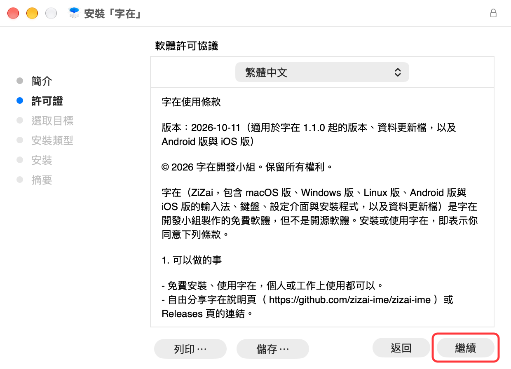
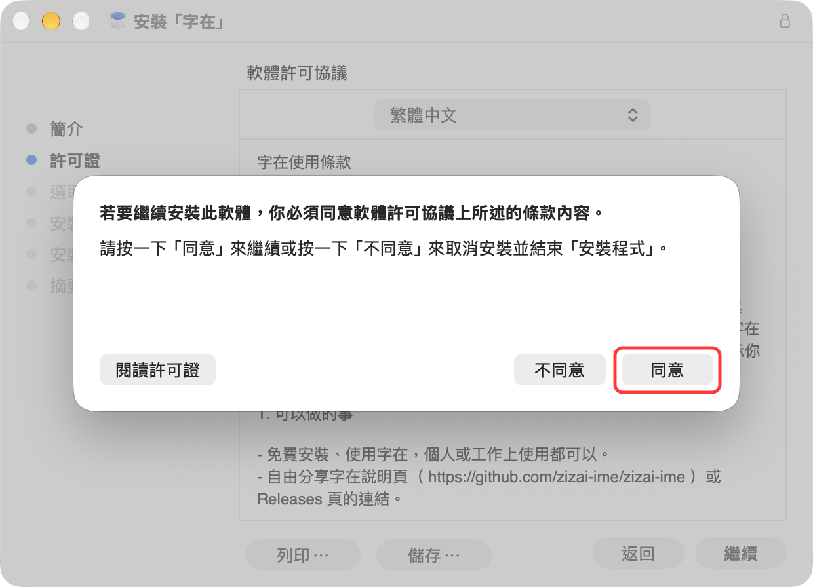
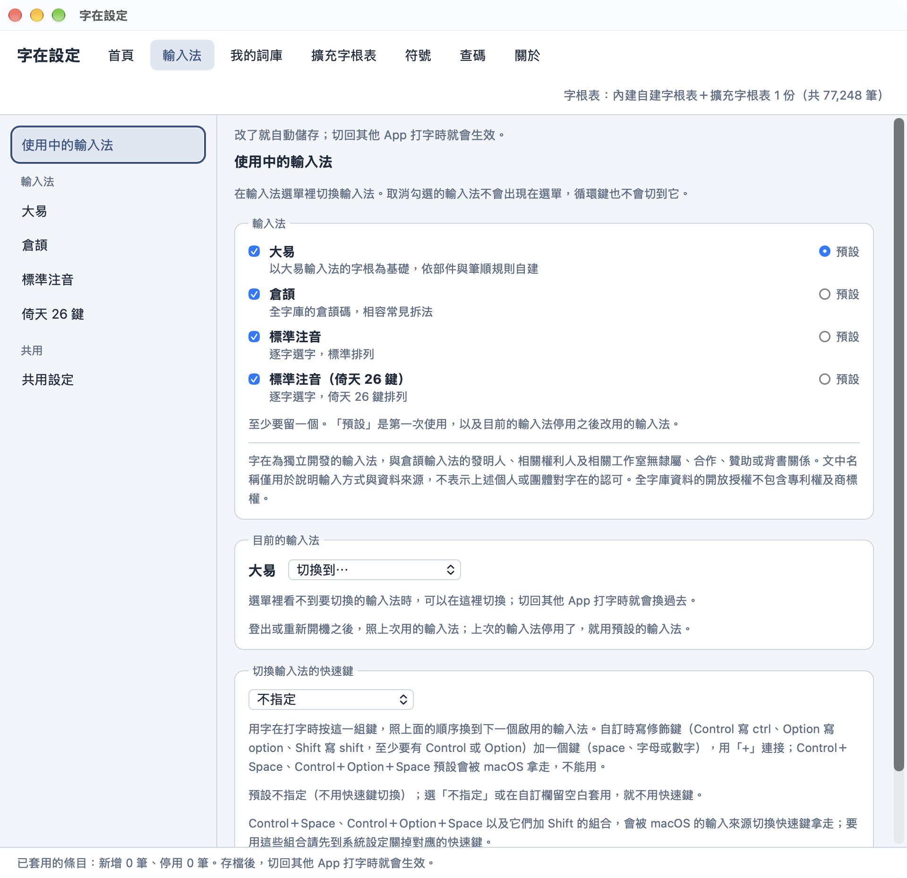
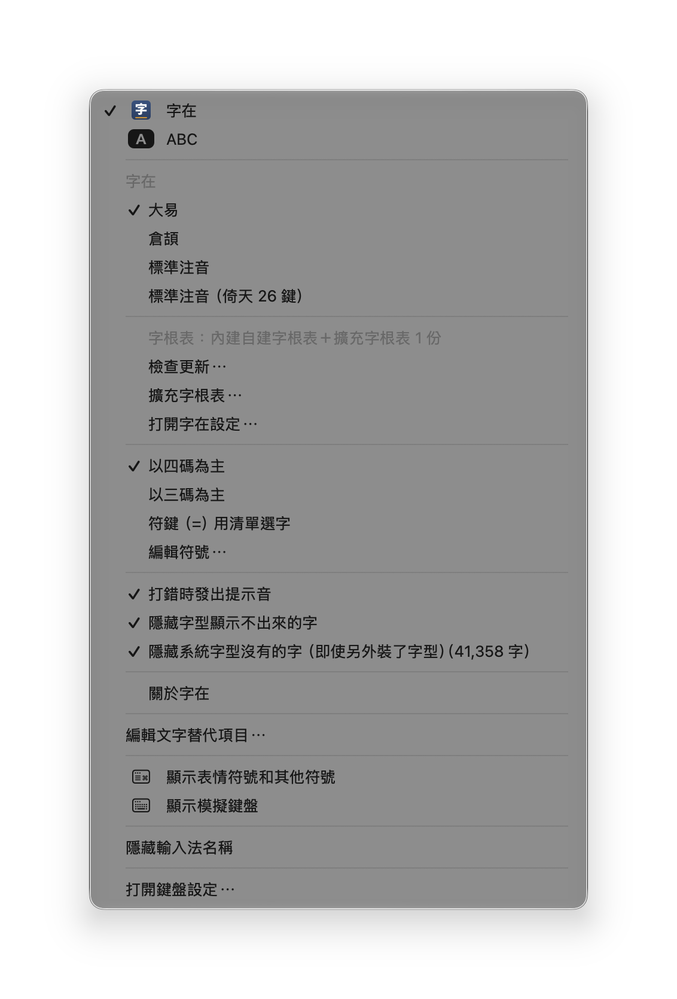
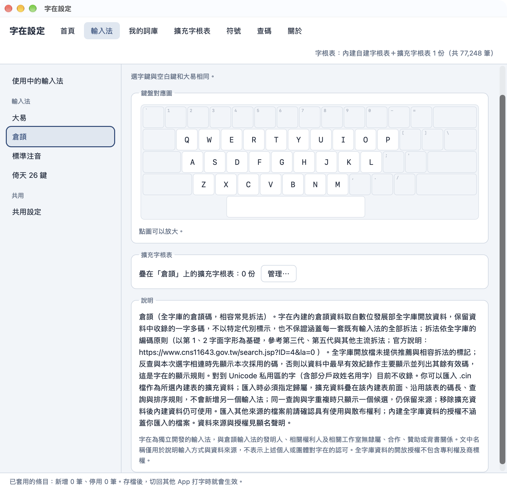
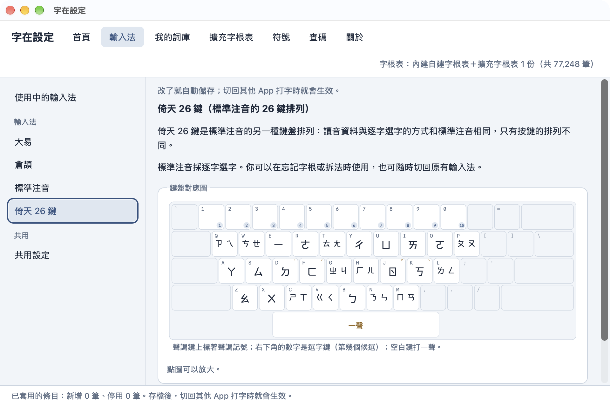

# 安裝與使用

這一頁是 macOS 版。打字、選字、字根表、補字與更新這些各版本相同的部分也寫在這裡；Windows 版、Linux 版的安裝、切換與解除安裝，見 [安裝與使用（Windows）](guide-windows.md) 與 [安裝與使用（Linux）](guide-linux.md)。

## 系統需求

macOS 13 以上。

## 安裝

macOS 版的最新版本是 1.3.0，更新內容與 SHA-256 見 [字在 1.3.0](https://github.com/zizai-ime/zizai-ime/releases/tag/v1.3.0)。

1. 從 [下載頁](../README.md#下載) 下載壓縮檔，解壓縮後按兩下 `ZiZai.pkg` 。Safari 預設會自動解壓縮，下載項目裡直接就是 `ZiZai.pkg` 。
2. 按「繼續」。

   

3. 看過「軟體許可協議」（字在的使用條款與隱私權政策的重點），按「繼續」：

   

   在跳出的視窗按「同意」（按「不同意」就不會安裝）：

   

4. 選「安裝供這部電腦的所有使用者使用」，按「繼續」。

   

5. 按「安裝」，輸入電腦的管理者密碼，裝好後按「關閉」。

   

6. 「系統設定」如果開著，先按 Command＋Q 結束它（它不會重新讀取輸入法清單）。
7. 打開「系統設定」→「鍵盤」，按「輸入方式」右邊的「編輯⋯」。

   

8. 按左下角的「＋」。

   

9. 左邊選「繁體中文」，右邊選「字在」，按「加入」。

   

找不到「字在」或只看到一列空白時，請登出再登入（只重開「系統設定」不夠）。「字在設定」會一起裝在「應用程式」資料夾。

## 切換輸入法

- 按 Control＋Space（macOS 預設的「選擇上一個輸入方式」），在「ABC」和「字在」之間切換。
- 如果在「輸入方式」裡開了「使用大寫鎖定鍵來切換『ABC』及目前輸入方式」，也可以按 Caps Lock 切換。
- 也可以從選單列的輸入法圖示選「字在」。

## 打字與選字

- 按字根鍵組字，組字區會顯示字根。
- 空白鍵送出第 1 個候選字。
- 選字鍵依序是 空白、`'`、`[`、`]`、`-`、`\`、`6`、`7`、`8`、`9`、`0`。
- 候選字不只一頁時，用方向鍵（← ↑ 上一頁、→ ↓ 下一頁）或 Page Up／Page Down 翻頁。
- 按 Esc 取消組字。
- 候選字視窗開著時直接打下一個字，會先送出第 1 個候選字。

## 輸入法

macOS 版有四種輸入法：大易、倉頡、標準注音，以及倚天 26 鍵（標準注音的另一種鍵盤排列）。Windows 版、Linux 版這版只有大易。

- **切換**：在選單列的輸入法選單選要用的輸入法。
- **不用的輸入法**：在「字在設定」的「輸入法」分頁，左側「使用中的輸入法」取消勾選，選單就不會列出它；至少要留一個。
- **鍵盤對應圖**：同一個分頁左側各輸入法的子頁都有。

<!-- 圖：mac-typing-dayi.png（212 清單序號 M21） -->

## 倉頡

- 內建的倉頡資料取自全字庫開放資料，拆法依全字庫的編碼原則。資料裡同一個字收了幾個碼都保留，用哪一個都打得出來。
- 選字鍵與空白鍵和大易相同。
- 可以在「字在設定」的「輸入法」分頁、左側「倉頡」子頁匯入 `.cin` 檔，當倉頡的擴充字根表，疊在內建資料前面。請使用你有權使用的 `.cin` 檔。
- 字在與任何既有輸入法沒有合作或隸屬關係，也未經其背書。

<!-- 圖：mac-typing-cangjie.png（212 清單序號 M22） -->

## 標準注音

- 逐字選字：打一個字的讀音，再從候選字視窗選字。忘記字根或拆法時可以用，也可以隨時切回原本的輸入法。
- 倚天 26 鍵是標準注音的另一種鍵盤排列，讀音資料與選字方式相同，只有按鍵的排列不同。在輸入法選單選標準注音或倚天 26 鍵那一項就換排列；兩種排列的鍵盤對應圖在「字在設定」的「輸入法」分頁，左側「標準注音」與「倚天 26 鍵」子頁。
- 空白鍵的用法與一頁列幾個字，這一版不能改。

<!-- 圖：mac-typing-phonetic.png（212 清單序號 M23） -->

## 三碼與四碼

這一節只適用大易。四碼字會自動推導出三碼，三碼、四碼都能打。在選單列的輸入法選單切換：

- **以四碼為主**（預設）：四碼的候選字依內建的順序排；動態字序只會把你常選的字和前 5 個裡的字對調。
- **以三碼為主**：三碼的候選字依常用程度排，首選比較準；少數字打四碼時順序會變。

## 動態字序

macOS 版 1.3.0 起，候選字的順序會依你的選字習慣慢慢調整；要清掉這台電腦上學到的字序，在「字在設定」首頁的「進階」按「清除動態字序紀錄」。這個功能一律開啟，不用設定。Windows 版、Linux 版還沒有這個功能。

<!-- 圖：mac-settings-2-advanced.png（212 清單序號 M12） -->

- **選過才換位**：在同一組輸入碼（注音是同一個讀音）選字時，前 5 個以外選過的字夠常選，就和前 5 個裡最少選的對調；比第 1 個多選一倍以上才換到第 1 個。其他字都在原本的位置；很久沒選的字會慢慢退回去。「很久」算的是你打了多少字，不是過了幾天：打得多的人退得快，打得少的人退得慢。
- **所有打法共用一份**：你選過的每個字各選了幾次，所有打法共用一份次數。在一種打法常選的字，在另一種打法選到時也會很快往前。
- **還原這組的順序**：不想讓某一組換位，在候選字視窗按右鍵選「還原這組的順序」（這組有換過位置的字時才有這一項），那一組就固定照原本的順序、不再學。
- **不連網**：這些紀錄只存在這台電腦上，不記句子、前後文、時間，也不會傳出去，見 [隱私權政策](../PRIVACY.md#動態字序)。

## 標點與符號

按 `=` 再按一顆鍵，打出中文標點、全形符號、注音符號、羅馬數字等，完整按法見 [符號字根表](symbols.md)。要加自己的符號或停用內建符號，到「字在設定」的「符號」分頁。

<!-- 圖：mac-typing-symbol.png（212 清單序號 M24） -->
<!-- 圖：mac-settings-9-symbols.png（212 清單序號 M19） -->

## 字根表

- **內建自建字根表**：「字在自建字根表（依部件與筆順規則自建）」，裝好就能用。內建字根表以大易輸入法的字根為基礎，拆字碼由程式依字在的取碼規則、全字庫的部件與筆順資料，以及人工指定與調整的字根清單產生，不是任何輸入法廠商的官方字根表。字在與任何輸入法廠商沒有合作或隸屬關係，也未經其背書。有些字的拆法可能和你習慣的不同，可以在「字在設定」的「擴充字根表」分頁替它們加上你習慣的輸入碼。
- **擴充字根表**：在「擴充字根表」分頁匯入 `.cin` 字根表，或自己建一份。擴充字根表疊在內建表上，同一個輸入碼時排在前面。

請使用你有權使用的 `.cin` 檔，匯入的字根表只供你自己使用。字在不附、也不提供下載任何第三方的字根表檔案。

## 補字與自訂輸入碼

在「字在設定」裡：

- **我的詞庫**：補字、替字加上自己的輸入碼、停用用不到的字。
- **查碼**：查字的輸入碼，也可以直接拿來補字或改碼。

改完自動套用，不必重新啟動輸入法。

## 版本與更新

打開「字在設定」，第一頁「首頁」就有主程式與資料的版本；從輸入法選單選「檢查更新…」也會打開這一頁。按「檢查更新」才會連到 GitHub 查有沒有新版，不會自動檢查，也不會送出你的任何資料，見 [隱私權政策](../PRIVACY.md)。

- **主程式**（輸入法與「字在設定」）：有新版時按「前往下載頁」，下載新的安裝檔，照「安裝」的步驟裝一次就會升級。詞庫、擴充字根表與設定都會保留。只有部分平台更新的版本，「檢查更新」不會顯示，見 [各平台的最新版本](../README.md#下載)。
- **資料**（字根表與字頻表）：有新的資料更新檔時，按「下載並看改了哪些字」，看過改了輸入碼的字再按「套用」，切回其他 App 打字時就會生效，不必重裝字在。

資料更新檔換掉的是內建的字根表與字頻表，擴充字根表照舊疊在上面，詞庫與設定不受影響。想換回內建的資料，按「改回內建資料」。

也可以自己從 [zizai-data 的 Releases](https://github.com/zizai-ime/zizai-data/releases) 下載 `.zizaipack` ，在首頁按「匯入資料更新檔…」，或在 Finder 裡按兩下這個檔。

首頁「進階」裡的「接受測試更新檔」是開發小組測試用的，平常不用打開；「清除動態字序紀錄」見 [動態字序](#動態字序)。

## 擴充區的字

內建字根表收錄 Unicode 擴充區的字，大多數要另外裝字型才顯示得出來。輸入法選單的「隱藏字型顯示不出來的字」預設開啟，這些字不會出現在候選字視窗。

想打這些字，可以安裝全字庫的字型：

1. 到政府資料開放平臺的全字庫資料集（ https://data.gov.tw/dataset/5961 ）下載 `Fonts_Sung.zip` （全字庫宋體，候選字視窗用它顯示擴充區的字）；要楷體可以另外下載 `Fonts_Kai.zip` 。
2. 解壓縮，選取所有字型檔，按兩下用「字體簿」安裝。
3. 登出再登入，字在會重新檢查哪些字顯示得出來，這些字就會出現在候選字視窗；**不用**關掉「隱藏字型顯示不出來的字」。

輸入法選單的「隱藏系統字型沒有的字（即使另外裝了字型）」預設關閉。打開後，只有另外安裝的字型才顯示得出來的字也不列入候選，適合文件要給沒裝字型的人看的時候。

全字庫字型由全字庫網站提供，依政府資料開放授權條款或 SIL Open Font License 1.1 授權；字在不附字型檔。

## 解除安裝

1. 打開「系統設定」→「鍵盤」，按「輸入方式」右邊的「編輯⋯」。

   

   選「字在」，按左下角的「−」移除。

   

2. 刪除下列項目（在 Finder 選「前往」→「前往檔案夾⋯」，輸入路徑；刪除時需要管理者密碼）：
   - `/Library/Input Methods/Zizai.app`
   - 「應用程式」資料夾裡的「字在設定」
   - `~/Library/Application Support/Zizai` （詞庫、擴充字根表與匯入的資料更新檔都在這裡；要保留就不要刪）
3. 要清除輸入法選單的選項（例如以四碼或三碼為主），在「終端機」執行 `defaults delete studio.mosil.inputmethod.zizai` 。
4. 登出再登入。

本頁截圖裡的 macOS 介面屬於 Apple，用來說明安裝與使用的步驟；部分截圖經過裁切，是字在開發小組做的。
