# 安裝與使用

這一頁是 macOS 版。打字、選字、字根表、補字與更新這些各版本相同的部分也寫在這裡；Windows 版、Linux 版的安裝、切換與解除安裝，見 [安裝與使用（Windows）](guide-windows.md) 與 [安裝與使用（Linux）](guide-linux.md)。「注音打詞」「首碼聯想」「字彙建議」三節講的是 macOS 版。Windows 版、Linux 版也有這三個功能，但有些地方不同，見 [安裝與使用（Windows）](guide-windows.md) 與 [安裝與使用（Linux）](guide-linux.md)；手機版有注音打詞（按法見 [Android](guide-android.md#注音打詞) 與 [iPhone、iPad](guide-ios.md#注音打詞)），沒有首碼聯想與字彙建議。

想先看整體的樣子：[功能預覽影片（手繪動畫，約半分鐘）](https://youtu.be/HSc9Hmme0D4)。

## 系統需求

macOS 13 以上。

## 安裝

macOS 版的最新版本是 1.4.2，更新內容與 SHA-256 見 [字在 1.4.2](https://github.com/zizai-ime/zizai-ime/releases/tag/v1.4.2)。

1. 從 [下載頁](../README.md#下載) 下載壓縮檔，解壓縮後按兩下 `ZiZai.pkg` 。Safari 預設會自動解壓縮，下載項目裡直接就是 `ZiZai.pkg` 。
2. 按「繼續」。

   

3. 看過「軟體許可協議」（字在的使用條款與隱私權政策的重點），按「繼續」：

   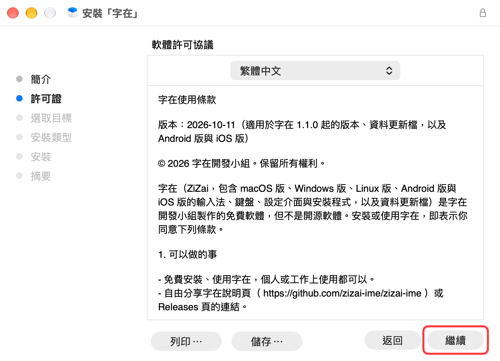

   在跳出的視窗按「同意」（按「不同意」就不會安裝）：

   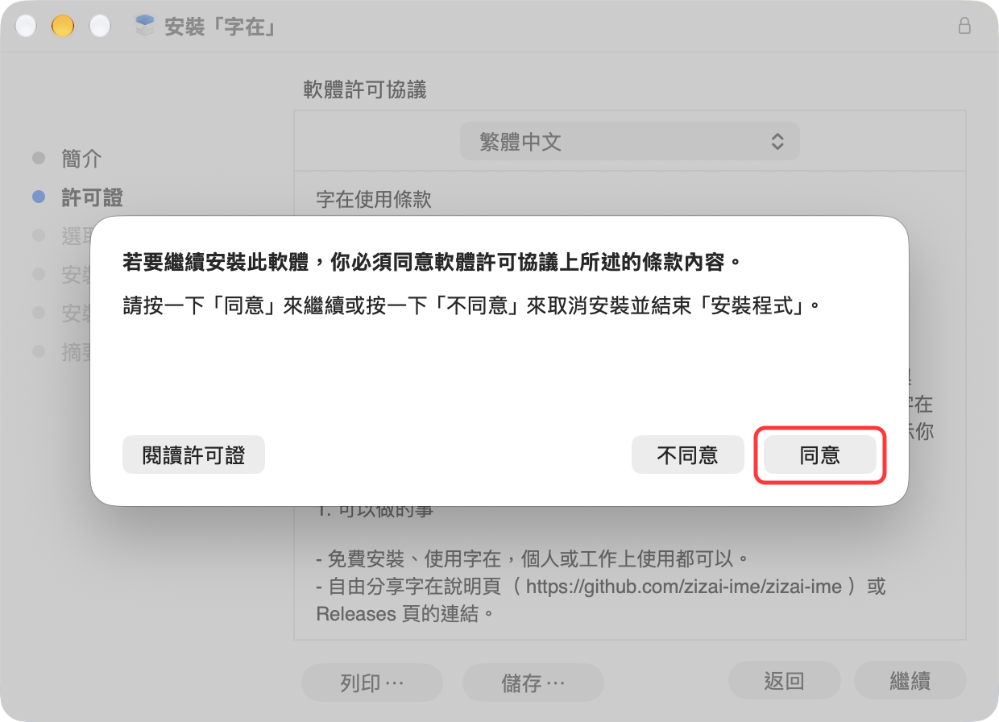

4. 選「安裝供這部電腦的所有使用者使用」，按「繼續」。

   

5. 按「安裝」，輸入電腦的管理者密碼，裝好後按「關閉」。

   

6. 「系統設定」如果開著，先按 Command＋Q 結束它（它不會重新讀取輸入法清單）。
7. 打開「系統設定」→「鍵盤」，按「輸入方式」右邊的「編輯⋯」。

   

8. 按左下角的「＋」。

   

9. 左邊選「繁體中文」，右邊選「字在」，按「加入」。

   

找不到「字在」或只看到一列空白時，請登出再登入（只重開「系統設定」不夠）。「字在設定」會一起裝在「應用程式」資料夾。

## 切換輸入法

- 按 Control＋Space（macOS 預設的「選擇上一個輸入方式」），在「ABC」和「字在」之間切換。
- 如果在「輸入方式」裡開了「使用大寫鎖定鍵來切換『ABC』及目前輸入方式」，也可以按 Caps Lock 切換。
- 也可以從選單列的輸入法圖示選「字在」。

## 打字與選字

- 按字根鍵組字，組字區會顯示字根。
- 空白鍵送出第 1 個候選字。
- 選字鍵依序是 空白、`'`、`[`、`]`、`-`、`\`、`6`、`7`、`8`、`9`、`0`。
- 候選字不只一頁時，用方向鍵（← ↑ 上一頁、→ ↓ 下一頁）或 Page Up／Page Down 翻頁。
- 按 Esc 取消組字。
- 候選字視窗開著時直接打下一個字，會先送出第 1 個候選字。
- 標準注音與倚天 26 鍵預設打詞，按鍵和上面不同，見 [注音打詞](#注音打詞)。

## 輸入法

macOS 版有四種輸入法：大易、倉頡、標準注音，以及倚天 26 鍵（標準注音的另一種鍵盤排列）。Windows 版 1.3.1 起、Linux 版與手機版（Android、iPhone、iPad）1.4.0 起也有這四種。

1.4.0 起，標準注音（標準排列）可以打詞；大易與標準注音（標準排列）有首碼聯想與字彙建議（標準注音的打詞與逐字都有）。1.4.2 起，倉頡也有首碼聯想與字彙建議；倚天 26 鍵這一種排列也有首碼聯想與字彙建議，也預設打詞（和標準排列共用「注音打詞」這個設定，改成逐字時兩種排列都逐字）。Windows 版、Linux 版也有這些功能，用法見各自的說明頁；手機版 1.4.0 起有注音打詞（倚天 26 鍵排列只能逐字），沒有首碼聯想與字彙建議。字在與任何輸入法廠商沒有合作或隸屬關係，也未經其背書。

- **切換**：在選單列的輸入法選單選要用的輸入法。
- **不用的輸入法**：在「字在設定」的「輸入法」分頁，左側「使用中的輸入法」取消勾選，選單就不會列出它；至少要留一個。
- **鍵盤對應圖**：同一個分頁左側各輸入法的子頁都有。
- **共用設定**：同一個分頁左側的「共用設定」，所有輸入法都照這裡：**打錯時發出提示音**（預設開啟）；**隱藏字型顯示不出來的字**（預設開啟）、**隱藏系統字型沒有的字**（預設關閉），見「擴充區的字」一節。這三項在選單列的輸入法選單也能切換。
- **字彙聯想**：同一個分頁左側「共用設定」下面的「字彙聯想」，大易、倉頡、標準注音與倚天 26 鍵共用：**首碼聯想**（預設開啟）、**聯想提示**（預設「立刻」）、**字彙建議**（預設關閉）與**不顯示字彙建議的 App**（預設「終端機」與 iTerm2）。見下面「首碼聯想」「字彙建議」兩節。
- **字彙領域**：也在「字彙聯想」，勾選首碼聯想與字彙建議要用的國家教育研究院樂詞網各領域名詞，預設只勾高中以下的教科書名詞，見下面「字彙領域」。
- **注音打詞**：在左側「標準注音」子頁，預設「打詞」，標準注音與倚天 26 鍵共用這個設定，見 [注音打詞](#注音打詞)。

改這些開關時，正在打的字會放棄，要重打。

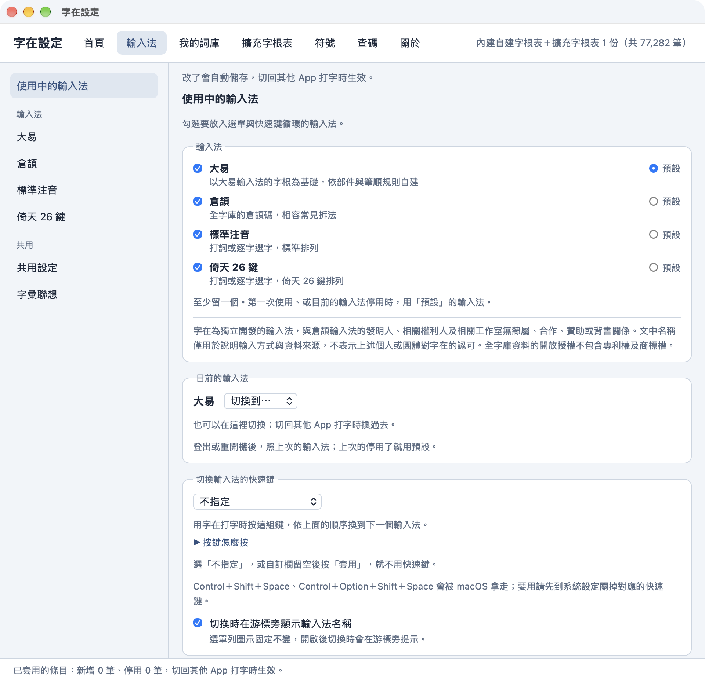

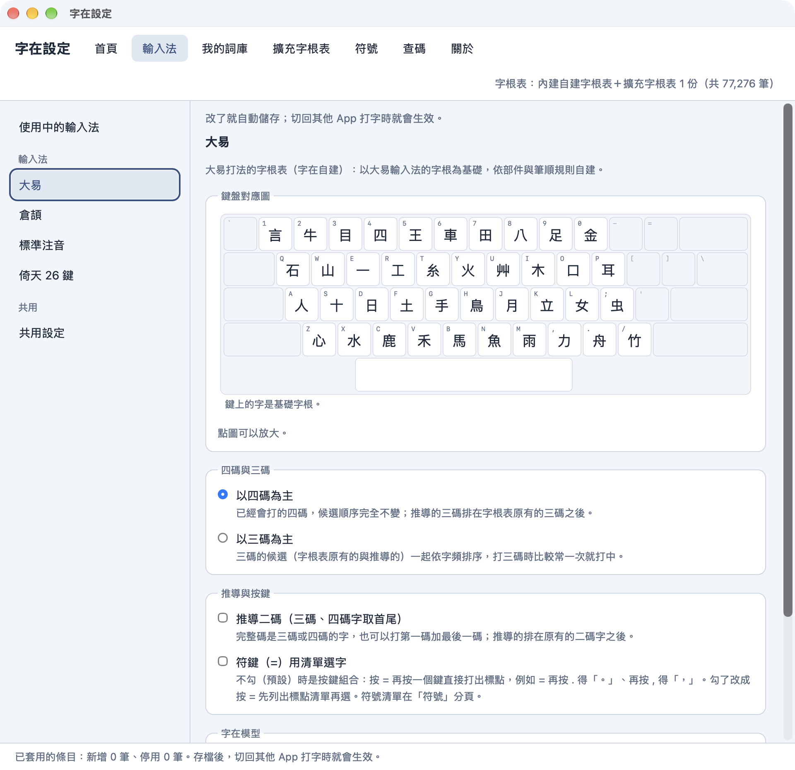

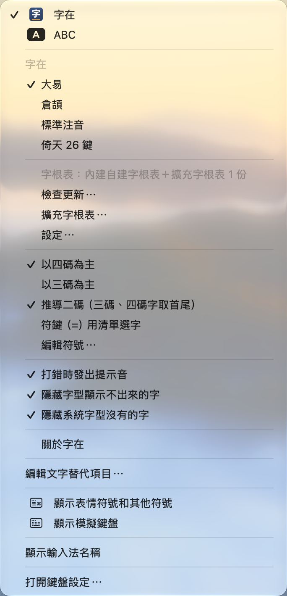

## 倉頡

- 內建的倉頡資料取自全字庫開放資料，拆法依全字庫的編碼原則。資料裡同一個字收了幾個碼都保留，用哪一個都打得出來。
- **候選預覽**：組字中每按一鍵，預覽列就列出目前打到這裡的候選，最多 10 個，標籤是 1～9 與 0。完整碼相符的字排在前面，接著是碼比較長、開頭相同的字。預覽列只是給你看，按鍵的意思不變。
- **選字**：預覽列開著時，直接按上排數字鍵選預覽列裡的字。按空白鍵時，完整碼只有一個字就直接送出，有兩個以上就打開候選字視窗。候選字視窗裡用上排數字鍵選第 1～10 個，空白鍵選第 1 個，一頁 10 個。
- **全形標點**：沒有組字時，逗號鍵、句號鍵、分號鍵等直接打出中文標點（，。；等）。組字中按這些鍵，會先送出第 1 個候選再打出標點；沒有候選時發出提示音，碼留著。
- **標點鍵清單**：左右中括號鍵、反斜線鍵、單引號鍵、斜線鍵等會打開一份標點清單，第 1 個已經選好，直接打下一個字就會先送出它；也可以用空白鍵或上排數字鍵選，按 Esc 或 Backspace 取消。這幾份清單不能在「符號」分頁停用或自訂。大寫鎖定開著時，這些鍵照半形。
- **兩個設定**：在「字在設定」的「輸入法」分頁、左側「倉頡」子頁的「打字」：「組字時顯示候選預覽」（預設開啟；關掉後要打完整個碼再按空白鍵）、「使用全形標點」（預設開啟；關掉時照半形，中文標點改用符鍵加標點鍵）。
- 可以在「字在設定」的「輸入法」分頁、左側「倉頡」子頁匯入 `.cin` 檔，當倉頡的擴充字根表，疊在內建資料前面。請使用你有權使用的 `.cin` 檔。
- 字在與任何既有輸入法沒有合作或隸屬關係，也未經其背書。

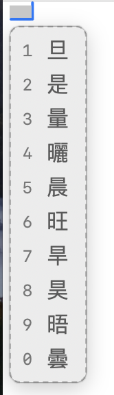

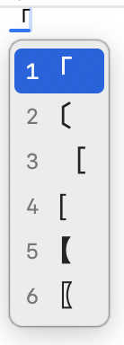

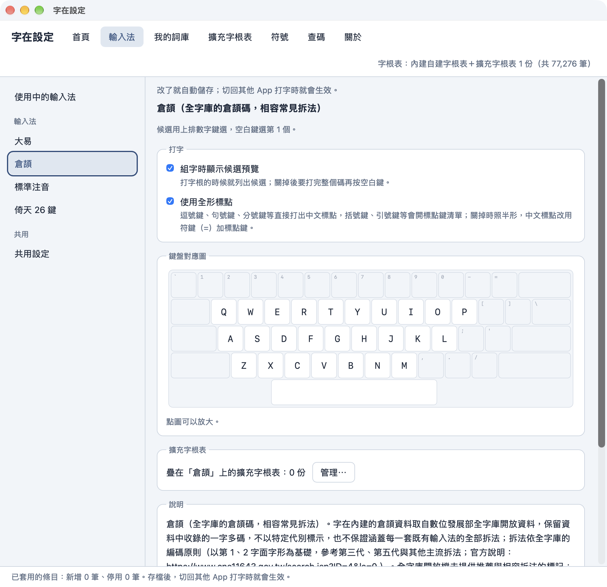

## 標準注音

標準注音有兩種打法，在「字在設定」的「輸入法」分頁、左側「標準注音」子頁的「注音打詞」切換：

- **打詞**（預設，1.4.0 起）：可以連打幾個字的讀音，再從候選裡選詞，見下面「注音打詞」。
- **逐字**：打一個字的讀音，再從候選字視窗選字；選了一個字才打下一個。

第一次切到標準注音或用到注音打詞時，會顯示一次說明；以前看過標準注音說明的人也會再看到一次新的說明。

忘記字根或拆法時可以用標準注音，也可以隨時切回原本的輸入法。

倚天 26 鍵是標準注音的另一種鍵盤排列，讀音資料相同，只有按鍵的排列不同。在輸入法選單選標準注音或倚天 26 鍵那一項就換排列；兩種排列的鍵盤對應圖在「字在設定」的「輸入法」分頁，左側「標準注音」與「倚天 26 鍵」子頁。1.4.2 起，倚天 26 鍵排列和標準排列一樣預設打詞，也可以用首碼聯想與字彙建議；「注音打詞」的設定在「標準注音」子頁，兩種排列共用。

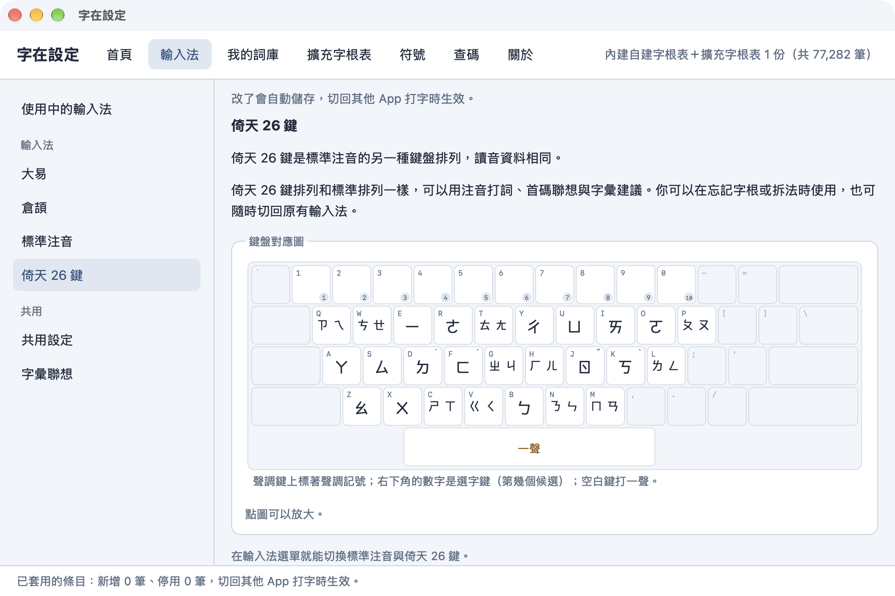

### 注音打詞

- **打第一個鍵就有候選**：組字區可以放好幾個字的讀音，候選一直顯示，排成一列跟在「Tab｜」後面。只打了一個字的讀音時，這一列是字（前面可能還有首碼聯想的詞）；接著打下一個字，對得上的詞就會出現在這一列。這一列不標選字鍵，打字時上排數字鍵照常是注音鍵；放不下的候選，這一列後面會寫還有幾個。
- **只打聲母也可以**：每個字只打聲母，也找得到詞，例如打一個常用詞每個字的聲母，那個詞就會出現在候選裡。
- **按 Tab 在這一列選**：第一次按 Tab 選第一個並加上底色，組字區換成選到的字詞；再按 Tab 換下一個，Shift＋Tab 換上一個，這一列會跟著捲動。這一列只有一個候選時，按 Tab 直接送出。
  - 選到之後按空白鍵或 Enter 送出；直接打下一個字的讀音或標點，會先送出選到的，再接著打。
  - 按 Esc 或退格只取消選擇，組字區回到原本的讀音；按聲調鍵、向下鍵這類其他的鍵，也會先取消選擇，再照平常的方式處理。
- **按空白鍵開始選**：還沒用 Tab 選的時候按空白鍵，最後一個字還沒標聲調時，按一下是把它當成一聲，留在原地，可以接著打下一個字；最後一個字已經有聲調時，打開候選字視窗，每一格標出選字鍵，右下角有頁碼；這個讀音沒有一聲時，按一下就打開。按向下鍵（向右鍵也可以）直接打開。空白鍵不會直接送出字。
- **選字的時候**：
  - 按上排數字鍵（選字鍵）選本頁的一個；空白鍵翻到下一頁，最後一頁再按就回到第一頁；Enter 選本頁第一個；向下鍵、向上鍵也能翻頁。
  - 在第一頁按向上鍵，或按 Esc、退格，只退出選字，組字區不變。
  - 打注音鍵（不是選字鍵的），先退出再照常打出那個注音。按到本頁沒有那一格的選字鍵時也一樣：標準排列的選字鍵都是注音鍵，會照常打出那個注音。
- **Enter**：還沒選的時候，送出打字候選裡的第一個；**Esc** 丟掉整個組字區。
- **連打幾個字時**：涵蓋這一整串的詞可以出現在第一個候選；選了比較短的詞時，後面的讀音還留在組字區。
- **選了詞之後**：送出選到的那一段，後面的讀音留在組字區，可以接著打或選。
- **首碼聯想**：打第一個字的讀音時，這一列前面會先列出接在前面的字後面的詞，後面才是打字的候選，按 Tab 一起輪流選；這些詞什麼時候出現，照「聯想提示」的設定。組字區有第二個字以後，這一列只有打字的候選。見 [首碼聯想](#首碼聯想)。
- **選過的詞往前排**：同樣的讀音再打一次時，你選過的詞會排到比較前面；換了常用的詞，新的詞也會再排回前面。用首碼聯想或字彙建議送出的詞也算你選過。選過的詞記在這台電腦，和單字的學習紀錄放在一起，「清除動態字序紀錄」時一起清掉。單字照「動態字序」一節。
- **詞庫**：常用詞，以及國家教育研究院的詞語表、教育部《國語辭典簡編本》《成語典》的詞條。大易、倚天、字在這類輸入法名稱也打得出來。「字彙領域」勾選的樂詞網名詞只用在首碼聯想與字彙建議，不會加進注音打詞的候選。字在與任何輸入法廠商沒有合作或隸屬關係，也未經其背書。
- **詞庫和「我的詞庫」不同**：打詞與聯想用的詞庫隨安裝檔附上，不在「我的詞庫」分頁裡，也不能在那裡取消勾選。

不想打詞時，把「注音打詞」改成「逐字」；正在打的字會放棄，要重打。

空白鍵怎麼作用、一頁列幾個，沒有設定可以改。

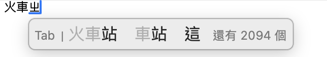

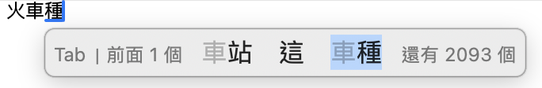

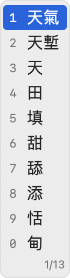

## 首碼聯想

1.4.0 起，大易與標準注音（標準排列）有首碼聯想，預設開啟；標準注音不論打詞或逐字都有。1.4.2 起，倉頡與倚天 26 鍵排列也有。送出一個字之後，打下一個字的第一個鍵，游標旁會提示開頭接得上的詞；組字中按 Tab，只有一個詞就直接送出，兩個以上時在提示裡輪流選，按空白鍵送出，或直接打下一個字。字在與任何輸入法廠商沒有合作或隸屬關係，也未經其背書。

- **聯想提示**：打了第一個鍵後，游標旁會出現一列「Tab｜」和接在後面的詞。出現的時機在「字在設定」的「聯想提示」選：
  - **立刻**（預設）：打了第一個鍵就出現。
  - **停頓後**：打了第一個鍵、停一下才出現；繼續打就不出現。
  - **不顯示**：不畫提示，但按 Tab 照樣查詞。
- **按 Tab 選詞**：組字中按 Tab：
  - 只有一個詞，直接送出。
  - 有兩個以上，第一個詞加上底色；再按 Tab 換下一個，Shift＋Tab 換上一個，按空白鍵或 Enter 送出選到的詞。詞太多放不下時，提示會跟著捲動。
  - 選到詞之後繼續打下一個字就會送出：打下一個字的鍵或標點，先送出選到的詞，再照平常的方式處理那個鍵，不用再按空白鍵或 Enter。
  - 選詞時按 Esc 或退格，只取消選詞，組字區不變；按字的候選字視窗的選字鍵，先取消選詞再選那個字；標準注音按聲調鍵是打完正在打的那個字，也會先取消選詞。
  - 提示還沒出現（或設成「不顯示」）時，第一次按 Tab 就顯示提示並選第一個詞；只有一個詞時直接送出。
- **送出的只有後面那一段**：前面已經送出的字不會再打一次。
- **倉頡**：首碼是下一個字的第一碼。
- **標準注音**：首碼是下一個字的第一個注音鍵；倚天 26 鍵排列一顆鍵上有幾個聲母時，這幾個聲母開頭的都算。注音打詞時，聯想的詞和打字的候選排在同一列（聯想的詞在前），按 Tab 一起輪流選；組字區有第二個字以後，這一列只有打字的候選。見 [注音打詞](#注音打詞)。
- **找不到詞時**：游標旁會閃一下「沒有聯想詞」，組字區不變。換欄位或剛開始打字、前面還沒有送出的字時，顯示「先打一個字才有聯想」。
- **前面的字從哪裡算**：只算你剛用字在送出的字，只放在記憶體裡、不寫進磁碟。換 App、切換到字在以外的輸入法、登出，或打了標點、英數、換行之後，就從頭算起；換欄位或點滑鼠換位置時，通常也會從頭算起。在字在裡換打法（例如從大易換到標準注音）時，前面送出的字照樣接著算，畫面上的提示會先收起來。
- **密碼欄位**：系統開啟安全輸入時（例如密碼欄位）不作用。
- **選過的詞往前排**：用首碼聯想送出的詞，和注音打詞時自己選的詞一樣記下次數，之後會往前排。
- **詞庫**：常用詞（日常詞與網路用語）、教育部《國語辭典簡編本》《成語典》的詞條，以及國家教育研究院樂詞網的名詞（預設只有高中以下的教科書名詞，其他領域見 [字彙領域](#字彙領域)）；沒選過的時候，常用詞以外補進來的詞排在常用詞後面。大易、倚天、字在這類輸入法名稱也打得出來。詞庫隨安裝檔附上，和「我的詞庫」分頁無關。
- **關掉**：在「字彙聯想」把「首碼聯想」取消勾選，Tab 就照原本交給 App。

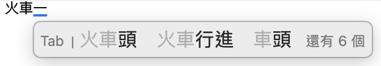

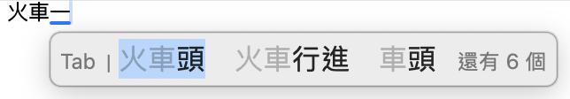

## 字彙建議

1.4.0 起，大易與標準注音（標準排列）可以打開字彙建議，**預設關閉**；1.4.2 起，倉頡與倚天 26 鍵排列也可以。打開後，剛送出字、還沒打下一個字時，游標旁會先用淡色顯示可能接著打的詞；按 Tab 採用，有幾個建議時在建議之間輪流選，按空白鍵送出，或直接打下一個字。字在與任何輸入法廠商沒有合作或隸屬關係，也未經其背書。

- **打開**：在「字在設定」的「輸入法」分頁、左側「字彙聯想」把「字彙建議」打勾。
- **按 Tab 採用**：只有一個建議時，Tab 直接採用；有幾個建議時，第一次按 Tab 選第一個並加上底色，選到的那個會先放在游標處（帶底線）；再按 Tab 換下一個，Shift＋Tab 換上一個，游標處跟著換。按空白鍵或 Enter 送出選到的那個；選到之後直接打下一個字或標點，也會先送出選到的那個，再照平常的方式打字。選的時候按 Esc 或退格只取消，拿掉游標處那一段，不刪字。
- **採用後的確認**：採用之後，原處會短暫顯示勾號和採用的字，再淡出。
- **不想用時**：直接打下一個字就好，建議會消失，你按的鍵照原本的方式處理。點滑鼠、捲動、換欄位、切換 App 或輸入法時，建議也會消失。還沒按 Tab 選的時候，空白鍵與 Enter 照原本交給 App。
- **小窗**：建議顯示在游標旁一個淡色的小窗，開頭是「Tab｜」。有些 App 問不到游標的位置，小窗會改出現在剛才打字的地方。
- **不顯示的地方**：系統開啟安全輸入時（例如密碼欄位）不顯示。「字彙聯想」裡有「不顯示字彙建議的 App」清單，預設是「終端機」與 iTerm2（Tab 在那裡是補完）；常用的程式編輯器或其他 App 也可以加進去，不要的可以刪掉。清單裡的 App 不顯示字彙建議，Tab 照原本交給 App。
- **要注意 Tab**：建議顯示的時候，Tab 會被拿去採用建議。在網頁表單打完字、建議還在時按 Tab，會採用建議而不是換到下一欄；程式編輯器的縮排也一樣。遇到時先按 Esc 讓建議消失，再按 Tab；常遇到的話也可以把字彙建議關掉。Word 與 Google 文件的表格裡，Tab 會先被拿去跳到下一格，字彙建議在那裡按 Tab 選不到詞，首碼聯想照樣可以用；不建議為了表格把 Word 或瀏覽器加進清單，那樣整個 App 都不會顯示字彙建議。Chrome 裡有些網頁的編輯器也會搶 Tab，Safari 也可能，見 [目前的限制](#目前的限制)。
- **選過的詞往前排**：用字彙建議送出的詞，和自己選的詞一樣記下次數，之後會往前排。
- **詞庫**：和首碼聯想同一份（含「字彙領域」勾選的領域）；排序另外參考兩個詞前後相連的常見程度。

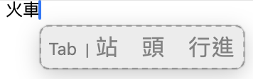

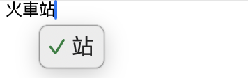

## 字彙領域

1.4.0 起，首碼聯想與字彙建議的詞庫，除了常用詞，還附了國家教育研究院樂詞網各領域的名詞：高中以下的教科書名詞、各學科的學術名詞、雙語詞彙，以及兩岸對照名詞（只收臺灣的寫法）。

- **勾選**：在「字在設定」的「輸入法」分頁、左側「字彙聯想」的「字彙領域」，勾選要用的領域；可以用搜尋框找領域。預設只勾高中以下的教科書名詞。
- **大類**：學術名詞底下再依學科分成數理與地球宇宙、海洋、生命科學、醫藥衛生、農林漁牧食品、工程與技術、人文社會與管理、藝術設計、其他幾個大類；這是字在依學科名稱歸的，不是樂詞網的官方分類。
- **全選**：每個分類與大類旁有「全選」，一次勾選或取消這一類（搜尋時被濾掉的也算）；這一類只勾了部分時，「全選」是半選的樣子。
- **大約幾個詞**：每個領域旁寫著大約有幾個詞，分類與大類旁是合計。勾得越多，聯想與建議裡的專業詞越多。
- **不會拖慢**：勾選的領域才會載入，勾得再多，打字也不會變慢。
- **只用在首碼聯想與字彙建議**：這些名詞不會加進注音打詞的候選；常用詞以外的名詞，沒選過的時候排在常用詞後面。
- 改了之後，正在打的字會放棄，要重打。
- 詞庫隨安裝檔附上，不連網下載；出處見 [使用條款與資料來源](../README.md#使用條款與資料來源)。

## 三碼與四碼

這一節只適用大易。四碼字會自動推導出三碼，三碼、四碼都能打。在選單列的輸入法選單切換：

- **以四碼為主**（預設）：四碼的候選字依內建的順序排；動態字序只會把你選得夠多的字往前排。
- **以三碼為主**：三碼的候選字依常用程度排，首選比較準；少數字打四碼時順序會變。

**推導二碼**（預設開啟）：完整碼是三碼或四碼的字，也可以打第一碼加最後一碼，推導的排在原有的二碼字之後。不需要時，在選單列的輸入法選單，或「字在設定」的「輸入法」分頁左側「大易」子頁，取消勾選「推導二碼（三碼、四碼字取首尾）」。以前關過這一項的，升級後照舊關著。

## 動態字序

macOS 版 1.3.0 起、Windows 版 1.3.1 起、Linux 版、Android 版與 iPhone、iPad 版 1.4.0 起，大易、倉頡、標準注音（含倚天 26 鍵排列）的候選字順序都會依你的選字習慣慢慢調整；1.4.0 起，五個平台的注音打詞時選過的詞也會往前排（見 [注音打詞](#注音打詞)）。要清掉這台電腦上學到的字序與詞的次數，在「字在設定」首頁的「進階」按「清除動態字序紀錄」。這個功能一律開啟，不用設定。手機版的清除與還原見 [Android](guide-android.md#動態字序) 與 [iPhone、iPad](guide-ios.md#動態字序)。

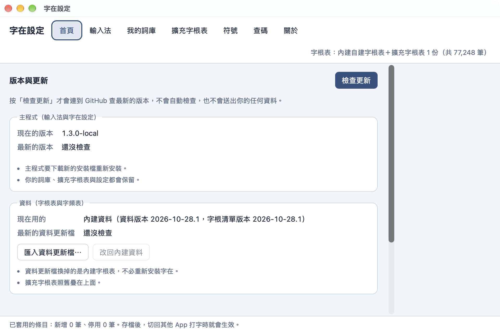

- **選過才換位**：在同一組輸入碼（注音是同一個讀音）選字時，選過的字比前面的字常選得夠多就會往前排，候選不論幾個都一樣。其他字都在原本的位置；很久沒選的字會慢慢退回去。「很久」算的是你打了多少字，不是過了幾天：打得多的人退得快，打得少的人退得慢。
- **小點記號**：位置換過的候選（往前排的字，和因此往後一格的字），選字鍵旁會有一個小點。
- **所有打法共用一份**：你選過的每個字各選了幾次，所有打法共用一份次數。在一種打法常選的字，在另一種打法選到時也會很快往前。
- **三種情況只記次數、不換位**：倉頡候選預覽列裡碼比目前打到的鍵串長的字；倚天 26 鍵打的一串鍵對到不只一個讀音時；只有一個候選的碼。這些情況選的字還是會記次數，在別的碼或讀音裡照常往前排。
- **還原這組的順序**：不想讓某一組換位，在候選字視窗按右鍵選「還原這組的順序」（這組有換過位置的字時才有這一項），那一組就固定照原本的順序、不再學。Windows 版的候選字視窗不能用滑鼠，沒有這一項；Linux 版也沒有這一項。
- **不連網**：這些紀錄存在這台電腦上，不記句子、前後文、時間，也不會傳出去；會不會被備份見 [隱私權政策](../PRIVACY.md#動態字序)。首碼聯想與字彙建議怎麼處理你剛送出的字，見 [隱私權政策](../PRIVACY.md#首碼聯想與字彙建議)。

## 標點與符號

按 `=` 再按一顆鍵，打出中文標點、全形符號、注音符號、羅馬數字等，完整按法見 [符號字根表](symbols.md)。要加自己的符號或停用內建符號，到「字在設定」的「符號」分頁。

## 字根表

- **內建自建字根表**：「字在自建字根表（依部件與筆順規則自建）」，裝好就能用。內建字根表以大易輸入法的字根為基礎，拆字碼由程式依字在的取碼規則、全字庫的部件與筆順資料，以及人工指定與調整的字根清單產生，不是任何輸入法廠商的官方字根表。字在與任何輸入法廠商沒有合作或隸屬關係，也未經其背書。有些字的拆法可能和你習慣的不同，可以在「字在設定」的「擴充字根表」分頁替它們加上你習慣的輸入碼。
- **擴充字根表**：在「擴充字根表」分頁匯入 `.cin` 字根表，或自己建一份。擴充字根表疊在內建表上，同一個輸入碼時排在前面。

請使用你有權使用的 `.cin` 檔，匯入的字根表只供你自己使用。除了由全字庫開放資料轉出的倉頡形碼表，字在不附、也不提供下載任何第三方的字根表檔案。

## 補字與自訂輸入碼

在「字在設定」裡：

- **我的詞庫**：補字、替字加上自己的輸入碼、停用用不到的字。
- **查碼**：查字的輸入碼，也可以直接拿來補字或改碼。

改完自動套用，不必重新啟動輸入法。

「我的詞庫」是你自己補的字與輸入碼。1.4.0 起標準注音打詞與首碼聯想用的詞庫隨安裝檔附上，不在「我的詞庫」分頁裡，也不能在那裡取消勾選；要關掉，見 [注音打詞](#注音打詞) 與 [首碼聯想](#首碼聯想)。

## 版本與更新

打開「字在設定」，第一頁「首頁」就有主程式與資料的版本；從輸入法選單選「檢查更新…」也會打開這一頁。按「檢查更新」才會連到 GitHub 查有沒有新版，不會自動檢查，也不會送出你的任何資料，見 [隱私權政策](../PRIVACY.md)。

- **主程式**（輸入法與「字在設定」）：有新版時按「前往下載頁」，下載新的安裝檔，照「安裝」的步驟裝一次就會升級。詞庫、擴充字根表與設定都會保留。只有部分平台更新的版本，「檢查更新」不會顯示，見 [各平台的最新版本](../README.md#下載)。
- **資料**（字根表與字頻表）：有新的資料更新檔時，按「下載並看改了哪些字」，看過改了輸入碼的字再按「套用」，切回其他 App 打字時就會生效，不必重裝字在。

資料更新檔換掉的是內建的字根表與字頻表，擴充字根表照舊疊在上面，詞庫與設定不受影響。想換回內建的資料，按「改回內建資料」。

也可以自己從 [zizai-data 的 Releases](https://github.com/zizai-ime/zizai-data/releases) 下載 `.zizaipack` ，在首頁按「匯入資料更新檔…」，或在 Finder 裡按兩下這個檔。

首頁「進階」裡的「接受測試更新檔」是開發小組測試用的，平常不用打開；「清除動態字序紀錄」見 [動態字序](#動態字序)。

## 擴充區的字

內建字根表收錄 Unicode 擴充區的字，大多數要另外裝字型才顯示得出來。輸入法選單的「隱藏字型顯示不出來的字」預設開啟，這些字不會出現在候選字視窗。

想打這些字，可以安裝全字庫的字型：

1. 到政府資料開放平臺的全字庫資料集（ https://data.gov.tw/dataset/5961 ）下載 `Fonts_Sung.zip` （全字庫宋體，候選字視窗用它顯示擴充區的字）；要楷體可以另外下載 `Fonts_Kai.zip` 。
2. 解壓縮，選取所有字型檔，按兩下用「字體簿」安裝。
3. 登出再登入，字在會重新檢查哪些字顯示得出來，這些字就會出現在候選字視窗；**不用**關掉「隱藏字型顯示不出來的字」。

輸入法選單的「隱藏系統字型沒有的字」預設關閉。打開後，只有另外安裝的字型才顯示得出來的字也不列入候選，適合文件要給沒裝字型的人看的時候。

全字庫字型由全字庫網站提供，依政府資料開放授權條款或 SIL Open Font License 1.1 授權；字在不附字型檔。

## 解除安裝

1. 打開「系統設定」→「鍵盤」，按「輸入方式」右邊的「編輯⋯」。

   

   選「字在」，按左下角的「−」移除。

   

2. 刪除下列項目（在 Finder 選「前往」→「前往檔案夾⋯」，輸入路徑；刪除時需要管理者密碼）：
   - `/Library/Input Methods/Zizai.app`
   - 「應用程式」資料夾裡的「字在設定」
   - `~/Library/Application Support/Zizai` （詞庫、擴充字根表與匯入的資料更新檔都在這裡；要保留就不要刪）
3. 要清除輸入法選單的選項（例如以四碼或三碼為主），在「終端機」執行 `defaults delete studio.mosil.inputmethod.zizai` 。
4. 登出再登入。

## 目前的限制

- **網頁裡的編輯器會搶 Tab**：在 Chrome 裡，有些網頁自己做的編輯器（例如 Threads、Facebook 的發文框）會把字在用來選詞的 Tab 也拿去用：跳到下一個按鈕，或多出一段空白；Safari 也可能這樣。Windows 版與 Linux 版不會這樣。在這類網頁裡不要按 Tab，照平常一個字一個字打；注音打詞時也可以按向下鍵（或向右鍵）打開候選字視窗選詞。

本頁截圖裡的 macOS 介面屬於 Apple，用來說明安裝與使用的步驟；部分截圖經過裁切，是字在開發小組做的。
