# 安裝與使用（Windows）

這一頁是 Windows 版的安裝、切換與解除安裝。打字、字根表、補字與更新和 macOS 版相同，見 [安裝與使用](guide-macos.md)。

**請先看這段**：Windows 版的安裝程式與輸入法還沒有數位簽章，Windows 會跳出安全警告。開了「智慧型應用程式控制」或由公司、學校管理的電腦，可能裝不起來，或裝好了也用不了字在（見「目前的限制」）。安裝前請先核對 SHA-256（「安裝」的第 2 步）。

## 下載

Windows 版的最新版本是 1.3.0，更新內容與 SHA-256 見 [字在 1.3.0](https://github.com/zizai-ime/zizai-ime/releases/tag/v1.3.0)。

<p align="center">
  <a href="https://github.com/zizai-ime/zizai-ime/releases/download/v1.3.0/ZiZai-Win-x64-1.3.0.zip"></a>
  <a href="https://github.com/zizai-ime/zizai-ime/releases/download/v1.3.0/ZiZai-Win-x86-1.3.0.zip"></a>
</p>

- **64 位元**（大多數電腦）：Windows 10、11。32 位元的 App 也能用字在。
- **32 位元**：32 位元的 Windows 10。
- 不知道是哪一種：到「設定」→「系統」→「系統資訊」（Windows 10 是「關於」），看「系統類型」是「64 位元作業系統」還是「32 位元作業系統」。

## 系統需求

- Windows 10 或 11，64 位元與 32 位元的檔案不同（見「下載」）。
- 「字在設定」要用 Microsoft Edge WebView2 。Windows 11 內建；沒有的話，安裝程式會連網下載安裝。
- 實際測過的是 Windows 11 Pro（組建 26300，64 位元，含 32 位元的 App）與全新安裝的 Windows 10 專業版 22H2（64 位元與 32 位元）。更早的 Windows 10 沒有實測，能安裝不代表一定相容。
- ARM64 的電腦還不支援，見「目前的限制」。

## 安裝

1. 從上面的「下載」下載符合電腦的檔案。請只從 GitHub 上 `zizai-ime/zizai-ime` 的 [Releases](https://github.com/zizai-ime/zizai-ime/releases) 下載。
2. 核對 SHA-256：在下載的資料夾空白處按右鍵，選「在終端機中開啟」（Windows 10 要按住 Shift 再按右鍵，選「在這裡開啟 PowerShell 視窗」），執行下面這行（ `<檔名>` 換成下載的檔名），把 Hash 欄的值和 Releases 頁面上的 SHA-256 比對：

   ```powershell
   Get-FileHash .\<檔名> -Algorithm SHA256
   ```

   不相同就不要安裝，刪掉重新下載。只看檔名不能確認內容。
3. 在下載的檔案上按右鍵，選「解壓縮全部」（Windows 11 沒看到的話，先按「顯示其他選項」）：

   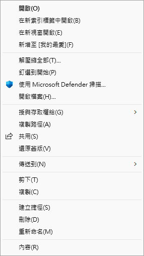

4. 按「解壓縮」，會打開裡面有 `ZiZai.exe` 的資料夾：

   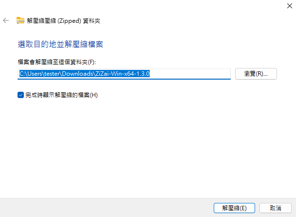

5. 按兩下 `ZiZai.exe` 。如果出現「Windows 已保護您的電腦」，表示 Windows 無法用數位簽章確認發行者，不代表檔案一定安全，也不代表一定有害。確定是從上面的 Releases 下載、SHA-256 也相符，要安裝的話再按「其他資訊」：

   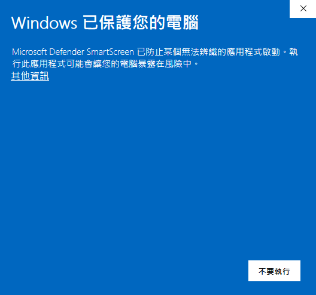

6. 確認「應用程式」是 `ZiZai.exe` ，按「仍要執行」。不確定來源、雜湊值不符、出現其他威脅警告，或沒有「仍要執行」時，請停止安裝：

   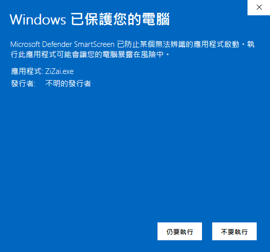

7. 「使用者帳戶控制」問是否允許變更時，按「是」。畫面和這裡寫的不同時，請停止。
8. 按「下一步」：

   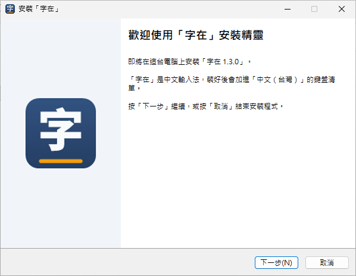

9. 看過「使用條款」，選「我同意」再按「下一步」開始安裝。按「取消」就不會安裝：

   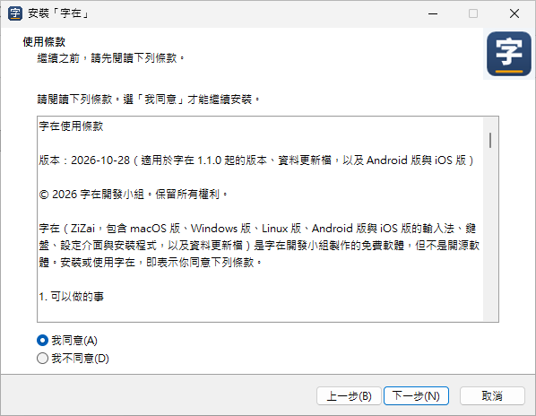

10. 看到「『字在』安裝完成」，按「完成」：

   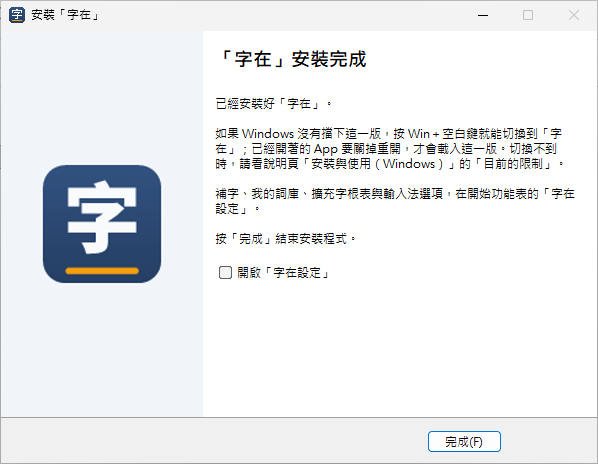

11. 「字在」會加進「繁體中文 (台灣)」的鍵盤清單。要確認的話：「設定」→「時間與語言」→「語言與地區」，按「繁體中文 (台灣)」右邊的「⋯」→「語言選項」，在「鍵盤」找「字在」（Windows 10 是「設定」→「時間與語言」→「語言」，點「繁體中文 (台灣)」再按「選項」）：

   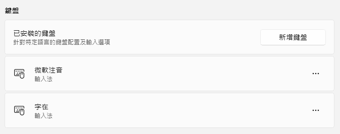

   沒有「字在」時，按「已安裝的鍵盤」右邊的「新增鍵盤」（Windows 10 在「鍵盤」下面），選「字在」。

「字在設定」會一起裝在開始功能表。程式在 `C:\Program Files\Zizai` ，詞庫、擴充字根表與設定在 `%APPDATA%\Zizai` 。

已經開著的 App 要關掉重開，才會用到剛裝好的字在，升級後也一樣。升級時直接執行新版的安裝程式，不必先解除安裝；「字在設定」開著的話，選「自動關閉這些應用程式」再按「下一步」。

## 切換輸入法

- 按 Win＋空白鍵，選「字在」：

   

- 切到「字在」後，工作列右下角會顯示「中」；按一下變成「英」，按鍵直接打英文，再按一下切回「中」：

    

## 打字與選字

打字、選字、三碼（由四碼推導）與四碼、標點與符號、字根表，和 macOS 版相同，見 [安裝與使用](guide-macos.md) 的「打字與選字」以後各節。macOS 版寫在「輸入法選單」的選項，Windows 版在「字在設定」的「輸入法」分頁。

倉頡與標準注音（含倚天 26 鍵）目前只有 macOS 版提供，Windows 版這版是大易；macOS 頁的「輸入法」「倉頡」「標準注音」三節不適用 Windows 版，說明見 [輸入法（macOS）](guide-macos.md#輸入法)。

<!-- 圖：win-typing-dayi.png（212 清單序號 W22） -->
<!-- 圖：win-typing-symbol.png（212 清單序號 W23） -->

內建的是「字在自建字根表（依部件與筆順規則自建）」：以大易輸入法的字根為基礎，拆字碼由程式依字在的取碼規則、全字庫的部件與筆順資料，以及人工指定與調整的字根清單產生，不是任何輸入法廠商的官方字根表。字在與任何輸入法廠商沒有合作或隸屬關係，也未經其背書。有些字的拆法可能和你習慣的不同，可以在「字在設定」的「擴充字根表」分頁替這些字加上你習慣的輸入碼。

## 字在設定

1. 按「開始」，搜尋「字在設定」並打開：

   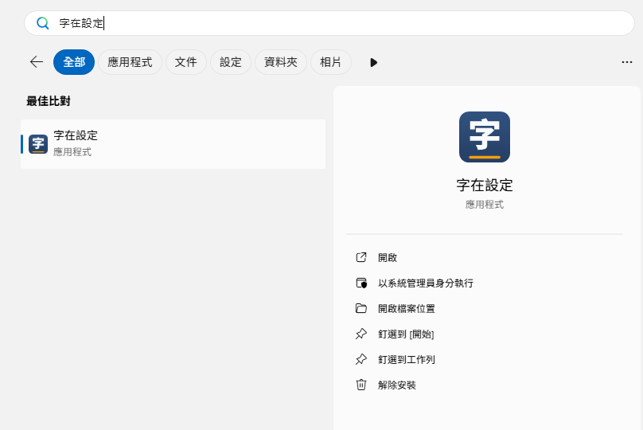

2. 「首頁」（版本與更新）和「我的詞庫」「擴充字根表」「符號」「查碼」的用法和 macOS 版相同，見 [安裝與使用](guide-macos.md) 的「標點與符號」到「版本與更新」各節。自己下載的資料更新檔（ `.zizaipack` ）也可以在檔案總管裡按兩下匯入。

   <!-- 圖：win-settings-3-home.png（212 清單序號 W17） -->
   <!-- 圖：win-settings-6-symbols.png（212 清單序號 W20） -->
   <!-- 圖：win-settings-7-about.png（212 清單序號 W21） -->

3. 「輸入法」分頁放的是 macOS 版在輸入法選單裡的選項，改了自動儲存，切回其他 App 打字時生效。左側分成三處：

   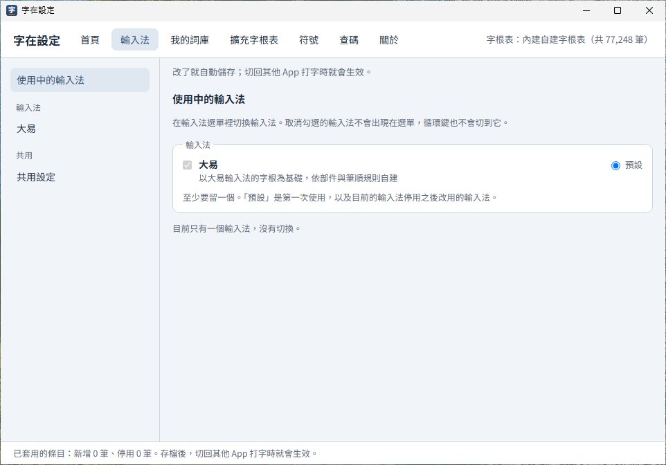

   <!-- 圖：win-settings-4-dayi.png（212 清單序號 W18） -->
   <!-- 圖：win-settings-5-shared.png（212 清單序號 W19） -->

   - **使用中的輸入法**：Windows 版這版只有大易，畫面上寫「目前只有一個輸入法，沒有切換」。
   - **大易**：鍵盤對應圖；**以四碼為主**（預設）／**以三碼為主**，和 macOS 版相同，三碼包含由四碼推導的三碼；**符鍵（=）用清單選字**（預設關閉），關閉時用按鍵組合，打開時先列出標點清單再選；擴充字根表。
   - **共用設定**：**打錯時發出提示音**（預設開啟）；**只列出常用字集的字**（預設開啟），擴充 B 以後的罕用字不列入候選；**隱藏字型顯示不出來的字**（預設開啟）、**隱藏系統字型沒有的字**（預設關閉），見下一節。

## 擴充區的字

「輸入法」分頁「共用設定」的「只列出常用字集的字」預設開啟，擴充 B 以後的罕用字不會出現在候選字視窗；自己補的字和擴充字根表的字照樣出現。想打這些字，取消勾選這一項。

取消之後，Windows 內建字型（細明體-ExtB 等）顯示得出來的字會出現在候選字視窗；所有字型都顯示不出來的字，「隱藏字型顯示不出來的字」（預設開啟）會藏起來。想打這些字，可以安裝全字庫的字型：

1. 到政府資料開放平臺的全字庫資料集（ https://data.gov.tw/dataset/5961 ）下載 `Fonts_Sung.zip` （全字庫宋體）；要楷體可以另外下載 `Fonts_Kai.zip` 。
2. 解壓縮，選取所有字型檔，按右鍵選「安裝」。
3. 重新開啟要打字的 App，字在會重新檢查哪些字顯示得出來。

「隱藏系統字型沒有的字（即使另外裝了字型）」預設關閉。打開後，只有另外安裝的字型才顯示得出來的字也不列入候選；對方看不看得到，仍要看對方的電腦與字型。

全字庫字型由全字庫網站提供，依政府資料開放授權條款或 SIL Open Font License 1.1 授權；字在不附字型檔。

## 解除安裝

1. 「設定」→「應用程式」→「已安裝的應用程式」，搜尋「字在」，按右邊的「⋯」→「解除安裝」，再按一次「解除安裝」（Windows 10 是「設定」→「應用程式」→「應用程式與功能」，點「字在」，按「解除安裝」，再按一次「解除安裝」確認）：

   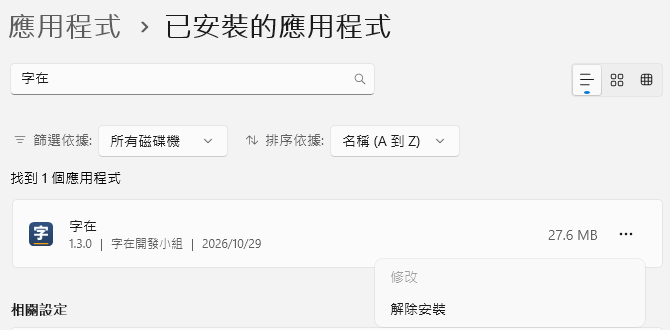

2. 「使用者帳戶控制」按「是」。問「確定要移除『字在』嗎？」時按「是」（只移除程式）：

   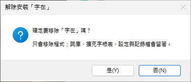

3. 看到「『字在』解除安裝完成」，按「確定」。「有些項目無法移除」指的是還開著的 App 正在用的檔案，重新開機時會自動刪除；沒有 App 在用字在時，訊息是「已經從這台電腦移除『字在』」：

   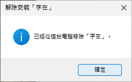

解除安裝會刪掉 `C:\Program Files\Zizai` 、開始功能表的「字在設定」，並從鍵盤清單移除「字在」。詞庫、擴充字根表、設定與匯入的資料更新檔（ `%APPDATA%\Zizai` ），以及記錄檔（ `%LOCALAPPDATA%\Zizai` 的 `tsf.log` 與 `tsf.log.1` ）會留著，重新安裝後還能用。不要了的話，關掉用過字在的 App，再刪掉這兩個資料夾，見 [隱私權政策](../PRIVACY.md)。

## 目前的限制

- 還沒有 ARM64 版。ARM64 的電腦可以安裝 x64 版，但原生 ARM64 的 App 用不了字在。
- 64 位元的 Windows 裝 x86 版時，安裝程式會擋下，請改用 x64 版（不然 64 位元的 App 用不了字在）。
- 安裝程式和輸入法還沒有數位簽章：
  - 安裝程式會被 SmartScreen 警告（「安裝」的第 5、6 步）。
  - 開了「智慧型應用程式控制」時，可能擋下未簽章的輸入法，字在就用不了（還沒實測）。狀態在「Windows 安全性」→「應用程式與瀏覽器控制」→「智慧型應用程式控制設定」。字在不會關掉這項保護，也請不要為了字在關掉它。
  - 公司、學校管理的電腦可能擋下安裝程式或輸入法，請洽系統管理員。
- 在測過的電腦上，每個載入字在的 App 約多用 50 MB 記憶體，實際用量依情況不同。
- 候選字視窗沒有深色模式，也不能用滑鼠選字。
- 只接受 UILess 輸入法的程式（例如部分全螢幕遊戲）用不了字在。
- 換了深色、淺色模式後，工作列的「中」「英」要切換一次輸入法才會換顏色。

遇到問題請到 GitHub 的 [Issues](https://github.com/zizai-ime/zizai-ime/issues) 回報。Issues 是公開的：不要貼記錄檔的原文，也不要上傳 `user.db` 、`user.pack` 或含個人資料的截圖；需要記錄時，我們會說明只要哪幾行。

本頁截圖裡的 Windows 介面屬於 Microsoft，用來說明安裝與使用的步驟；紅框與裁切是字在開發小組加的。
