# 安裝與使用（Windows）

這一頁是 Windows 版的安裝、切換與解除安裝。打字、字根表、補字與更新和 macOS 版相同，見 [安裝與使用](guide-macos.md)。

**請先看這段**：Windows 版的安裝程式與輸入法還沒有數位簽章，Windows 會跳出安全警告。開了「智慧型應用程式控制」或由公司、學校管理的電腦，可能裝不起來，或裝好了也用不了字在（見「目前的限制」）。安裝前請先核對 SHA-256（「安裝」的第 2 步）。

## 下載

Windows 版的最新版本是 1.3.1，更新內容與 SHA-256 見 [字在 1.3.1](https://github.com/zizai-ime/zizai-ime/releases/tag/v1.3.1)。

<p align="center">
  <a href="https://github.com/zizai-ime/zizai-ime/releases/download/v1.3.1/ZiZai-Win-x64-1.3.1.zip"></a>
  <a href="https://github.com/zizai-ime/zizai-ime/releases/download/v1.3.1/ZiZai-Win-x86-1.3.1.zip"></a>
</p>

- **64 位元**（大多數電腦）：Windows 10、11。32 位元的 App 也能用字在。
- **32 位元**：32 位元的 Windows 10。
- 不知道是哪一種：到「設定」→「系統」→「系統資訊」（Windows 10 是「關於」），看「系統類型」是「64 位元作業系統」還是「32 位元作業系統」。

## 系統需求

- Windows 10 或 11，64 位元與 32 位元的檔案不同（見「下載」）。
- 「字在設定」要用 Microsoft Edge WebView2 。Windows 11 內建；沒有的話，安裝程式會連網下載安裝。
- 實際測過的是 Windows 11 Pro（組建 26300，64 位元，含 32 位元的 App）與全新安裝的 Windows 10 專業版 22H2（64 位元與 32 位元）。更早的 Windows 10 沒有實測，能安裝不代表一定相容。
- ARM64 的電腦還不支援，見「目前的限制」。

## 安裝

1. 從上面的「下載」下載符合電腦的檔案。請只從 GitHub 上 `zizai-ime/zizai-ime` 的 [Releases](https://github.com/zizai-ime/zizai-ime/releases) 下載。
2. 核對 SHA-256：在下載的資料夾空白處按右鍵，選「在終端機中開啟」（Windows 10 要按住 Shift 再按右鍵，選「在這裡開啟 PowerShell 視窗」），執行下面這行（ `<檔名>` 換成下載的檔名），把 Hash 欄的值和 Releases 頁面上的 SHA-256 比對：

   ```powershell
   Get-FileHash .\<檔名> -Algorithm SHA256
   ```

   不相同就不要安裝，刪掉重新下載。只看檔名不能確認內容。
3. 在下載的檔案上按右鍵，選「解壓縮全部」（Windows 11 沒看到的話，先按「顯示其他選項」）：

   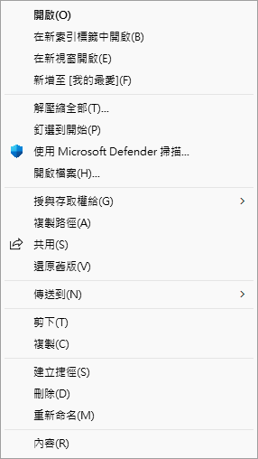

4. 按「解壓縮」，會打開裡面有 `ZiZai.exe` 的資料夾：

   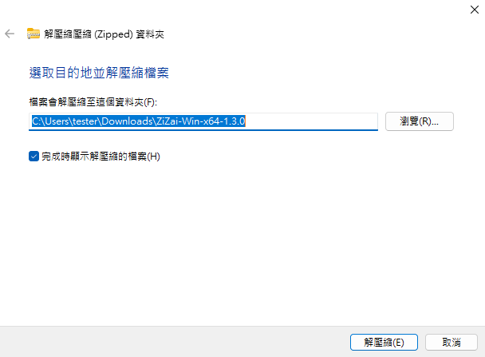

5. 按兩下 `ZiZai.exe` 。如果出現「Windows 已保護您的電腦」，表示 Windows 無法用數位簽章確認發行者，不代表檔案一定安全，也不代表一定有害。確定是從上面的 Releases 下載、SHA-256 也相符，要安裝的話再按「其他資訊」：

   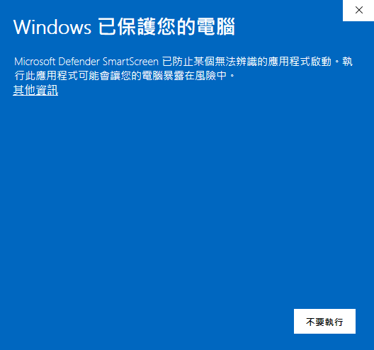

6. 確認「應用程式」是 `ZiZai.exe` ，按「仍要執行」。不確定來源、雜湊值不符、出現其他威脅警告，或沒有「仍要執行」時，請停止安裝：

   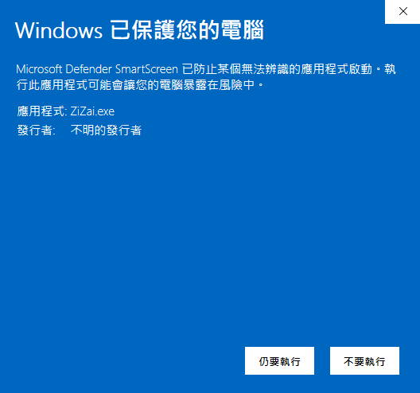

7. 「使用者帳戶控制」問是否允許變更時，按「是」。畫面和這裡寫的不同時，請停止。
8. 按「下一步」：

   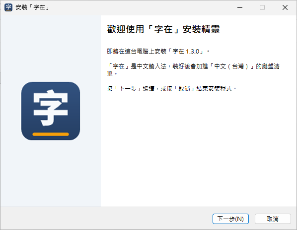

9. 看過「使用條款」，選「我同意」再按「下一步」開始安裝。按「取消」就不會安裝：

   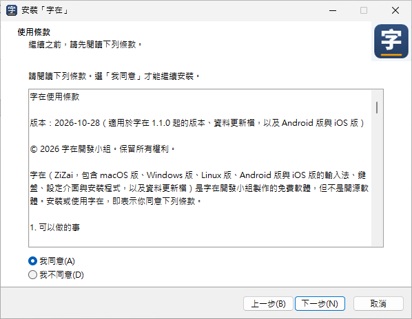

10. 看到「『字在』安裝完成」，按「完成」。補字、我的詞庫、擴充字根表與「輸入法」分頁的設定，在開始功能表的「字在設定」：

   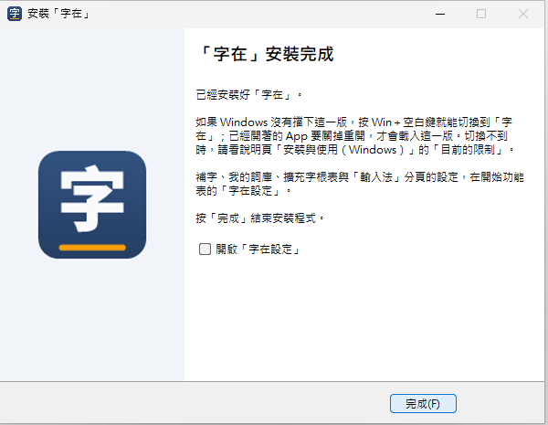

11. 「字在」會加進「繁體中文 (台灣)」的鍵盤清單。要確認的話：「設定」→「時間與語言」→「語言與地區」，按「繁體中文 (台灣)」右邊的「⋯」→「語言選項」，在「鍵盤」找「字在」（Windows 10 是「設定」→「時間與語言」→「語言」，點「繁體中文 (台灣)」再按「選項」）：

   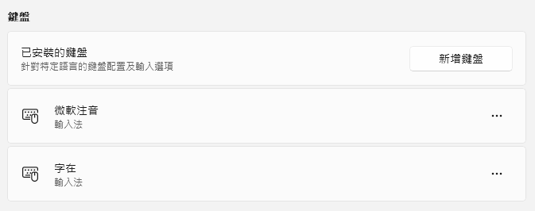

   沒有「字在」時，按「已安裝的鍵盤」右邊的「新增鍵盤」（Windows 10 在「鍵盤」下面），選「字在」。

「字在設定」會一起裝在開始功能表。程式在 `C:\Program Files\Zizai` ，詞庫、擴充字根表與設定在 `%APPDATA%\Zizai` 。

升級時直接執行新版的安裝程式，不必先解除安裝；「字在設定」開著的話，選「自動關閉這些應用程式」再按「下一步」。安裝或升級時已經開著的 App（例如檔案總管、瀏覽器）仍載著舊版或還沒載入字在，要關掉重開那個 App，或登出再登入，才會用到剛裝好的字在。

## 切換輸入法

- 按 Win＋空白鍵，選「字在」：

   

- 切到「字在」後，工作列右下角會顯示「中」；按一下變成「英」，按鍵直接打英文，再按一下切回「中」：

    

### 四種輸入法

Windows 版 1.3.1 起有四種輸入法：大易、倉頡、標準注音，以及倚天 26 鍵（標準注音的另一種鍵盤排列），都在「字在」裡面，不用另外加鍵盤。

- 在工作列的「中」「英」按鈕上按右鍵，選單列出四項，目前用的打勾；選另一項就換過去。按一下（左鍵）照舊是切換中英。
  1. 大易
  2. 倉頡
  3. 標準注音
  4. 標準注音（倚天 26 鍵）

   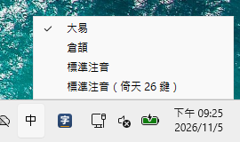

- 滑鼠停在按鈕上，提示文字會寫出目前的輸入法，例如「字在：中文・倉頡（按一下切換成英文，按右鍵換打法）」。
- 換過去時，游標旁會短暫顯示輸入法的名稱；不想看到，在「字在設定」的「輸入法」分頁、左側「使用中的輸入法」取消勾選「切換時在游標旁顯示輸入法名稱」。
- 所有 App 共用目前的輸入法，登出或重新開機之後照上次用的。
- **快速鍵**：預設沒有。要用的話，在「字在設定」的「輸入法」分頁、左側「使用中的輸入法」的「切換輸入法的快速鍵」選一組，用字在打字時按它，就照順序換到下一個啟用的輸入法；Ctrl＋Space、Ctrl＋Alt＋Space 不能用。這個設定存在 `%APPDATA%\Zizai\ime\settings.json` 的 `cycleShortcut` ，空字串是不指定。
- 不用的輸入法，在「使用中的輸入法」取消勾選，選單與快速鍵就不會切到它；至少要留一個。

## 打字與選字

打字、選字、三碼（由四碼推導）與四碼、推導二碼、標點與符號、字根表，和 macOS 版相同，見 [安裝與使用](guide-macos.md) 的「打字與選字」以後各節。macOS 版寫在「輸入法選單」的選項，Windows 版在「字在設定」的「輸入法」分頁。倉頡、標準注音、倚天 26 鍵與動態字序見下面各節。

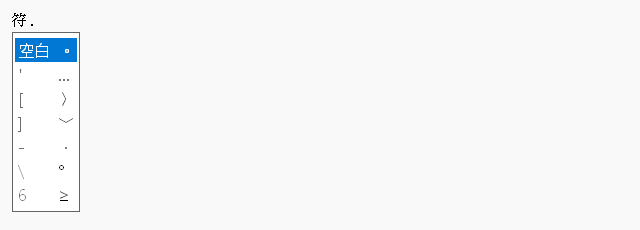

內建的是「字在自建字根表（依部件與筆順規則自建）」：以大易輸入法的字根為基礎，拆字碼由程式依字在的取碼規則、全字庫的部件與筆順資料，以及人工指定與調整的字根清單產生，不是任何輸入法廠商的官方字根表。字在與任何輸入法廠商沒有合作或隸屬關係，也未經其背書。有些字的拆法可能和你習慣的不同，可以在「字在設定」的「擴充字根表」分頁替這些字加上你習慣的輸入碼。

## 倉頡

- 內建的倉頡資料取自全字庫開放資料，拆法依全字庫的編碼原則。資料裡同一個字收了幾個碼都保留，用哪一個都打得出來。
- **候選預覽**：組字中每按一鍵，預覽列就列出目前打到這裡的候選，最多 10 個，標籤是 1～9 與 0。完整碼相符的字排在前面，接著是碼比較長、開頭相同的字。預覽列只是給你看，按鍵的意思不變。

   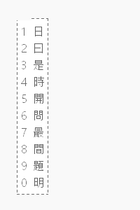

- **選字**：預覽列開著時，直接按上排數字鍵選預覽列裡的字。按空白鍵時，完整碼只有一個字就直接送出，有兩個以上就打開候選字視窗。候選字視窗裡用上排數字鍵選第 1～10 個，空白鍵選第 1 個，一頁 10 個。
- **全形標點**：沒有組字時，逗號鍵、句號鍵、分號鍵等直接打出中文標點（，。；等）。組字中按這些鍵，會先送出第 1 個候選再打出標點；沒有候選時發出提示音，碼留著。
- **標點鍵清單**：左右中括號鍵、反斜線鍵、單引號鍵、斜線鍵等會打開一份標點清單，第 1 個已經選好，直接打下一個字就會先送出它；也可以用空白鍵或上排數字鍵選，按 Esc 或 Backspace 取消。這幾份清單不能在「符號」分頁停用或自訂。大寫鎖定開著時，這些鍵照半形。

   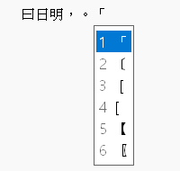

- **兩個設定**：在「字在設定」的「輸入法」分頁、左側「倉頡」：「組字時顯示候選預覽」（預設開啟；關掉後要打完整個碼再按空白鍵）、「使用全形標點」（預設開啟；關掉時照半形，中文標點改用符鍵加標點鍵）。同一頁可以匯入 `.cin` 檔，當倉頡的擴充字根表，疊在內建資料前面。請使用你有權使用的 `.cin` 檔。
- 字在與任何既有輸入法沒有合作或隸屬關係，也未經其背書。

## 標準注音

- **逐字選字**：打一個字的讀音，再從候選字視窗選字。忘記字根或拆法時可以用，也可以隨時切回原本的輸入法。

   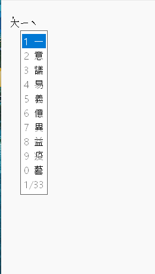

- **照鍵盤位置打**：標準注音照按鍵在鍵盤上的位置對應，不看 Windows 目前的鍵盤配置；用的不是美式鍵盤配置時，也照位置打，以「字在設定」的鍵盤對應圖為準。
- **鍵盤對應圖**：在「字在設定」的「輸入法」分頁，左側「標準注音」子頁。

   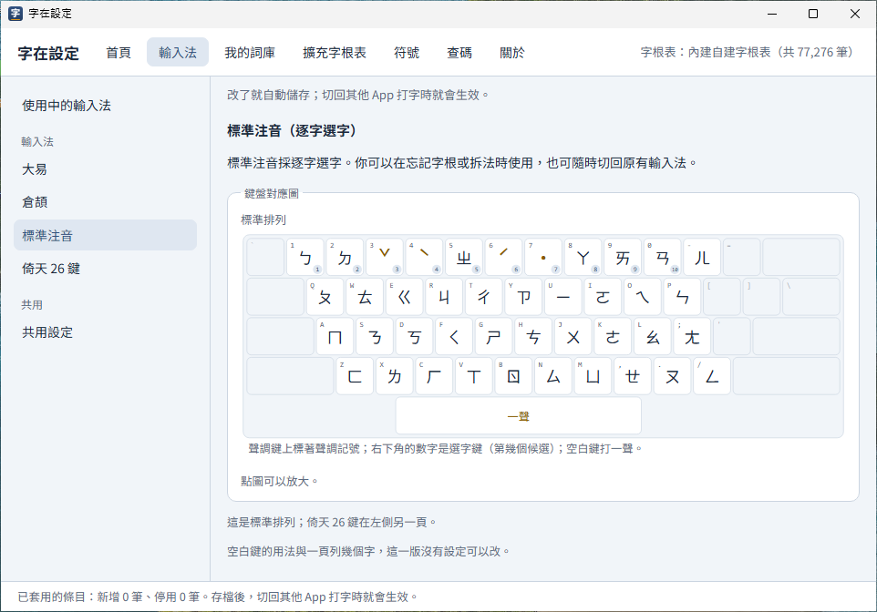

- 空白鍵的用法與一頁列幾個字，這一版不能改。

## 倚天 26 鍵

- 倚天 26 鍵是標準注音的另一種鍵盤排列，讀音資料與選字方式相同，只有按鍵的排列不同。和標準注音一樣照鍵盤位置打，非美式的鍵盤配置也以位置為準。
- **換排列**：在工作列「中」「英」按鈕的右鍵選單，選「標準注音」或「標準注音（倚天 26 鍵）」就換排列；「字在設定」裡沒有另外的排列選項。
- **鍵盤對應圖**：在「字在設定」的「輸入法」分頁，左側「倚天 26 鍵」子頁。

   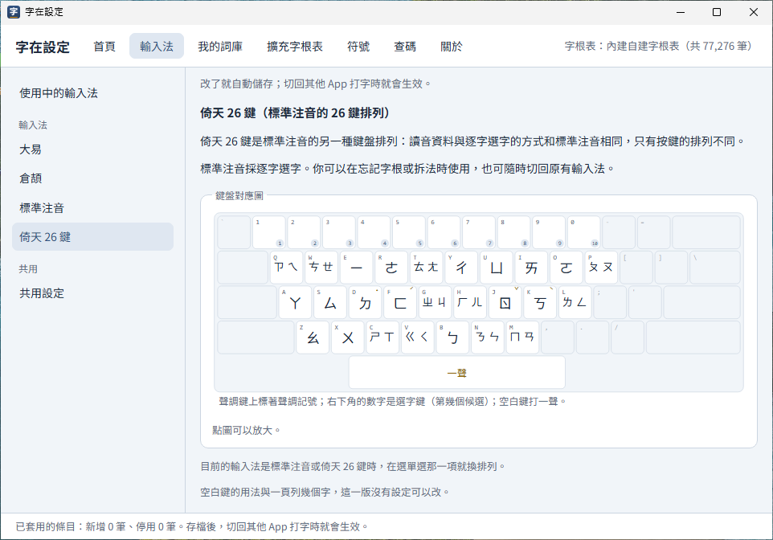

- 字在與任何既有輸入法沒有合作或隸屬關係，也未經其背書。

## 動態字序

Windows 版 1.3.1 起，候選字的順序會依你的選字習慣慢慢調整，規則和 macOS 版相同，見 [動態字序](guide-macos.md#動態字序)。這個功能一律開啟，不用設定。

- **小點記號**：位置換過的候選（往前排的字，和因此往後一格的字），選字鍵旁會有一個小點。
- **清除**：在「字在設定」首頁的「進階」按「清除動態字序紀錄」，就回到原本的順序。Windows 版的候選字視窗不能用滑鼠，沒有 macOS 版右鍵選單的「還原這組的順序」。
- **沙箱 App**：開始功能表的搜尋、市集 App 這類在沙箱裡執行的 App，照原本的順序排、不記錄。
- **不連網**：紀錄只存在這台電腦的 `%LOCALAPPDATA%\Zizai\learn\` ，不記句子、前後文、時間，也不會傳出去，見 [隱私權政策](../PRIVACY.md#動態字序)。

## 字在設定

1. 按「開始」，搜尋「字在設定」並打開：

   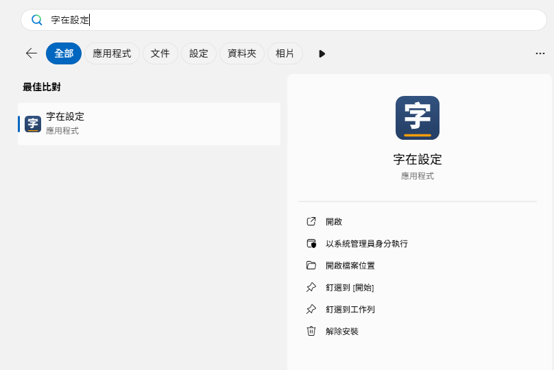

2. 「首頁」（版本與更新）和「我的詞庫」「擴充字根表」「符號」「查碼」的用法和 macOS 版相同，見 [安裝與使用](guide-macos.md) 的「標點與符號」到「版本與更新」各節。自己下載的資料更新檔（ `.zizaipack` ）也可以在檔案總管裡按兩下匯入。

   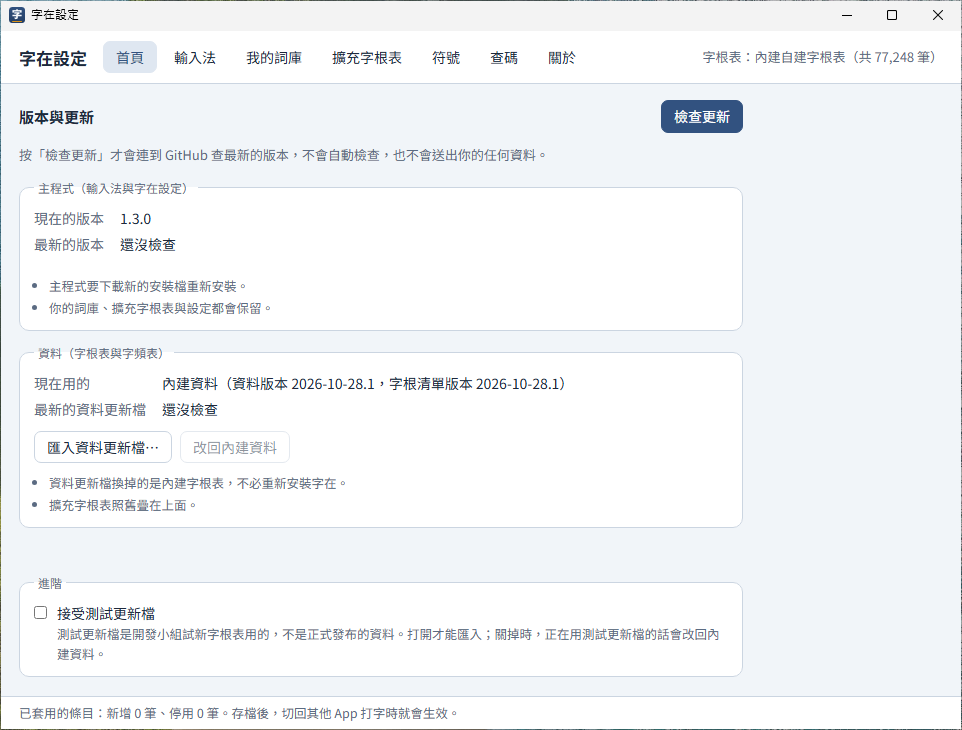

   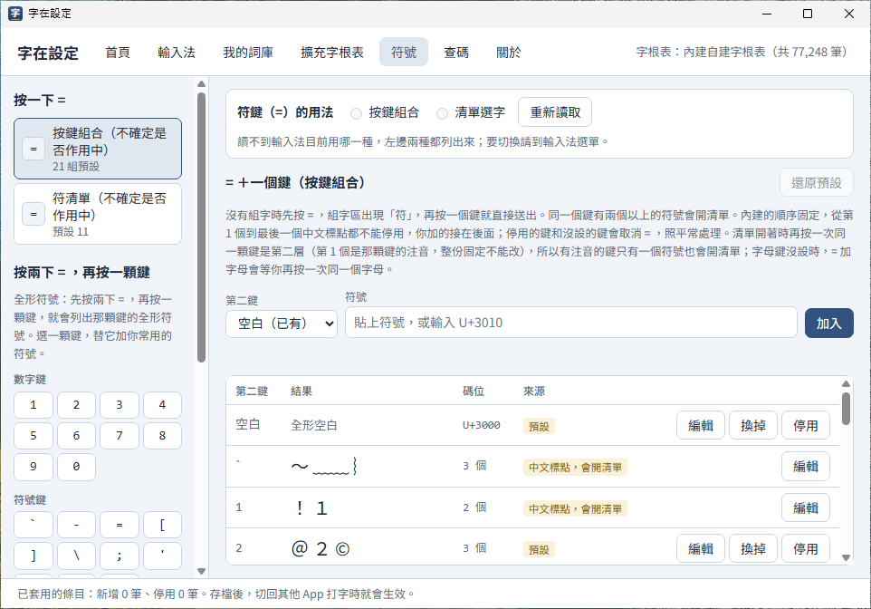

   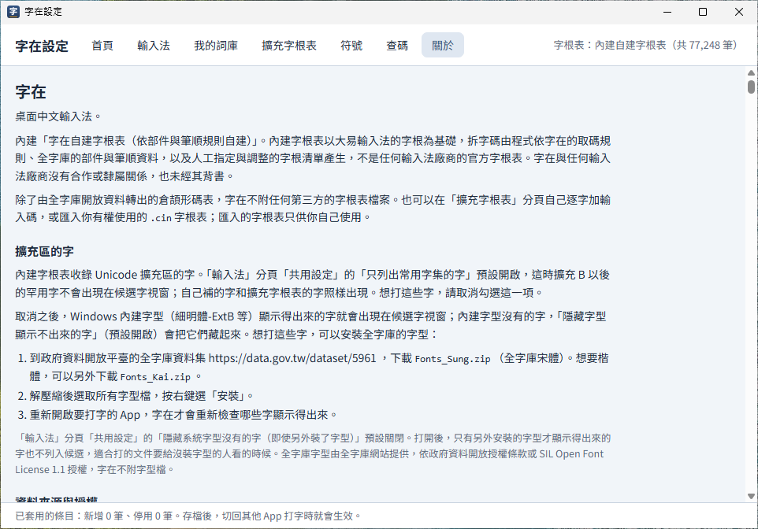

3. 「輸入法」分頁放的是 macOS 版在輸入法選單裡的選項，改了自動儲存，切回其他 App 打字時生效。左側分成六處：

   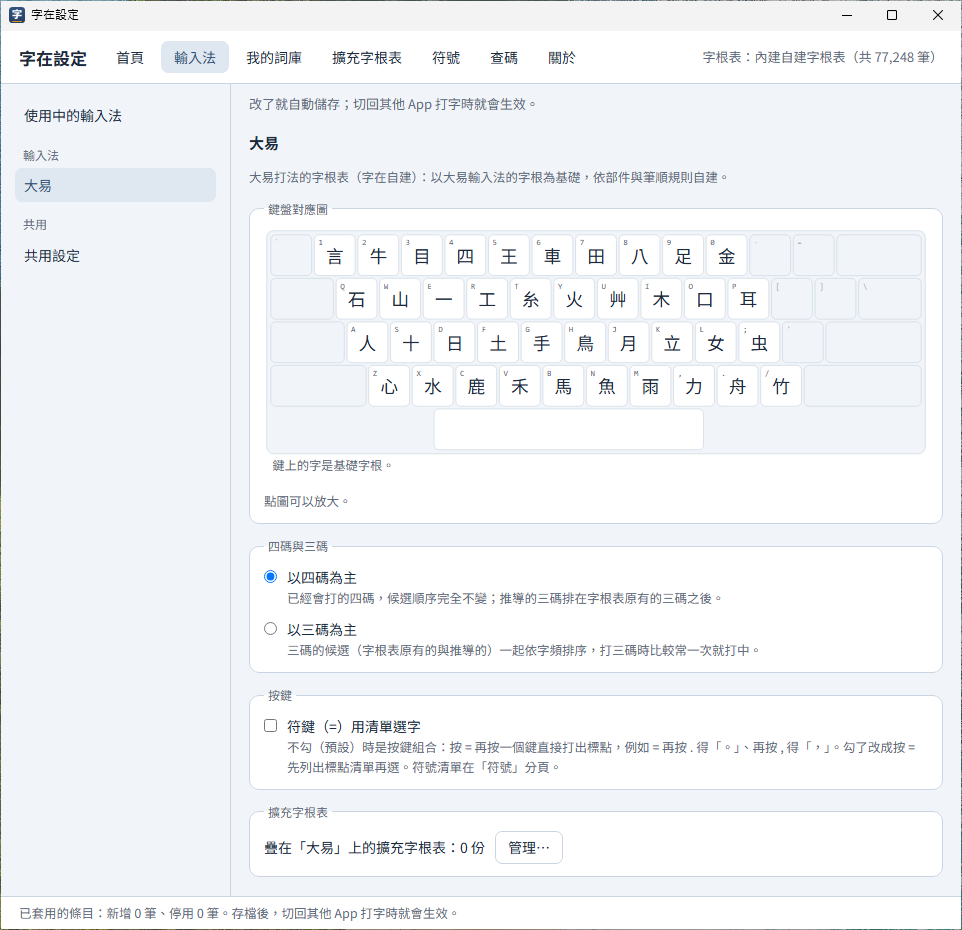

   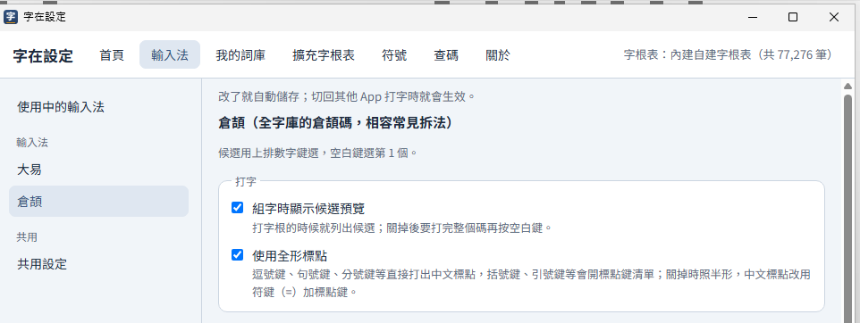

   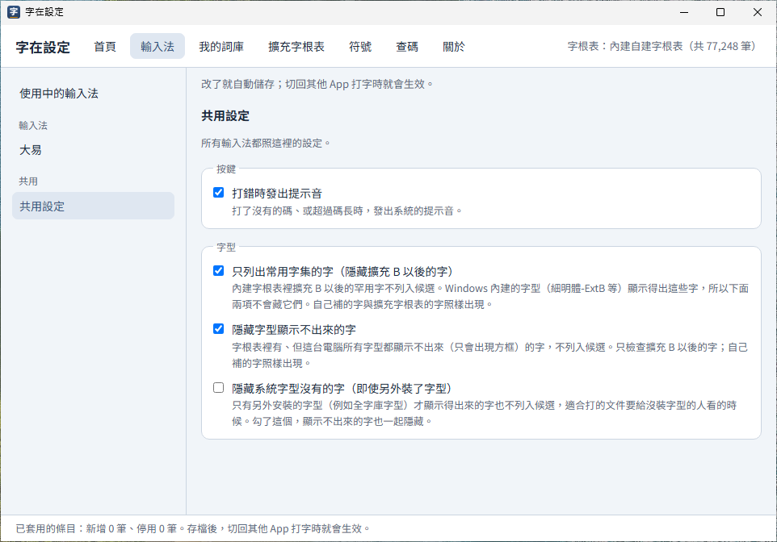

   - **使用中的輸入法**：大易、倉頡、標準注音、倚天 26 鍵，可以取消勾選不用的、指定預設的輸入法，也可以在這裡切換目前的輸入法、指定切換的快速鍵，見「切換輸入法」。
   - **大易**：鍵盤對應圖；**以四碼為主**（預設）／**以三碼為主**，和 macOS 版相同，三碼包含由四碼推導的三碼；**推導二碼（三碼、四碼字取首尾）**（預設開啟）；**符鍵（=）用清單選字**（預設關閉），關閉時用按鍵組合，打開時先列出標點清單再選；擴充字根表。
   - **倉頡**：鍵盤對應圖；**組字時顯示候選預覽**、**使用全形標點**（都預設開啟），見「倉頡」；擴充字根表。
   - **標準注音**、**倚天 26 鍵**：兩種排列的鍵盤對應圖，見「標準注音」「倚天 26 鍵」。
   - **共用設定**：**打錯時發出提示音**（預設開啟）；**只列出常用字集的字**（預設開啟），擴充 B 以後的罕用字不列入候選；**隱藏字型顯示不出來的字**（預設開啟）、**隱藏系統字型沒有的字**（預設關閉），見下一節。

## 擴充區的字

「輸入法」分頁「共用設定」的「只列出常用字集的字」預設開啟，擴充 B 以後的罕用字不會出現在候選字視窗；自己補的字和擴充字根表的字照樣出現。想打這些字，取消勾選這一項。

取消之後，Windows 內建字型（細明體-ExtB 等）顯示得出來的字會出現在候選字視窗；所有字型都顯示不出來的字，「隱藏字型顯示不出來的字」（預設開啟）會藏起來。想打這些字，可以安裝全字庫的字型：

1. 到政府資料開放平臺的全字庫資料集（ https://data.gov.tw/dataset/5961 ）下載 `Fonts_Sung.zip` （全字庫宋體）；要楷體可以另外下載 `Fonts_Kai.zip` 。
2. 解壓縮，選取所有字型檔，按右鍵選「安裝」。
3. 重新開啟要打字的 App，字在會重新檢查哪些字顯示得出來。

「隱藏系統字型沒有的字（即使另外裝了字型）」預設關閉。打開後，只有另外安裝的字型才顯示得出來的字也不列入候選；對方看不看得到，仍要看對方的電腦與字型。

全字庫字型由全字庫網站提供，依政府資料開放授權條款或 SIL Open Font License 1.1 授權；字在不附字型檔。

## 解除安裝

1. 「設定」→「應用程式」→「已安裝的應用程式」，搜尋「字在」，按右邊的「⋯」→「解除安裝」，再按一次「解除安裝」（Windows 10 是「設定」→「應用程式」→「應用程式與功能」，點「字在」，按「解除安裝」，再按一次「解除安裝」確認）：

   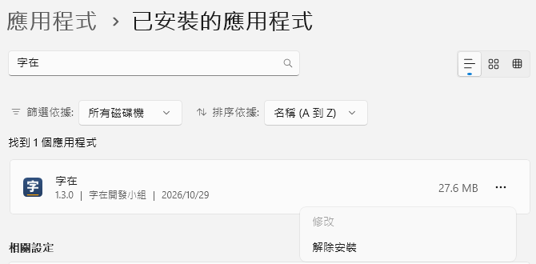

2. 「使用者帳戶控制」按「是」。問「確定要移除『字在』嗎？」時按「是」（只移除程式）：

   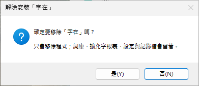

3. 看到「已經從這台電腦移除『字在』。」，按「確定」。還有 App 正在用字在時，訊息是「『字在』解除安裝完成」，並多一行「有些項目無法移除」，指的是那些 App 正在用的檔案，重新開機時會自動刪除：

   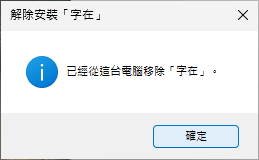

解除安裝會刪掉 `C:\Program Files\Zizai` 、開始功能表的「字在設定」，並從鍵盤清單移除「字在」。詞庫、擴充字根表、設定與匯入的資料更新檔（ `%APPDATA%\Zizai` ），以及記錄檔（ `%LOCALAPPDATA%\Zizai` 的 `tsf.log` 與 `tsf.log.1` ）會留著，重新安裝後還能用。不要了的話，關掉用過字在的 App，再刪掉這兩個資料夾，見 [隱私權政策](../PRIVACY.md)。

## 目前的限制

- 還沒有 ARM64 版。ARM64 的電腦可以安裝 x64 版，但原生 ARM64 的 App 用不了字在。
- 64 位元的 Windows 裝 x86 版時，安裝程式會擋下，請改用 x64 版（不然 64 位元的 App 用不了字在）。
- 安裝程式和輸入法還沒有數位簽章：
  - 安裝程式會被 SmartScreen 警告（「安裝」的第 5、6 步）。
  - 開了「智慧型應用程式控制」時，可能擋下未簽章的輸入法，字在就用不了（還沒實測）。狀態在「Windows 安全性」→「應用程式與瀏覽器控制」→「智慧型應用程式控制設定」。字在不會關掉這項保護，也請不要為了字在關掉它。
  - 公司、學校管理的電腦可能擋下安裝程式或輸入法，請洽系統管理員。
- 在測過的電腦上，每個載入字在的 App 約多用 50 MB 記憶體，實際用量依情況不同。
- 候選字視窗沒有深色模式，也不能用滑鼠選字。
- 只接受 UILess 輸入法的程式（例如部分全螢幕遊戲）用不了字在。
- 換了深色、淺色模式後，工作列的「中」「英」要切換一次輸入法才會換顏色。

遇到問題請到 GitHub 的 [Issues](https://github.com/zizai-ime/zizai-ime/issues) 回報。Issues 是公開的：不要貼記錄檔的原文，也不要上傳 `user.db` 、`user.pack` 或含個人資料的截圖；需要記錄時，我們會說明只要哪幾行。

本頁截圖裡的 Windows 介面屬於 Microsoft，用來說明安裝與使用的步驟；部分截圖經過裁切，是字在開發小組做的。
